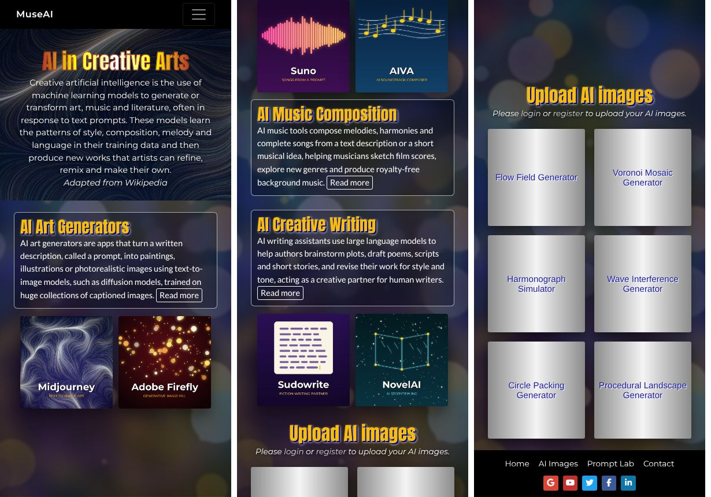
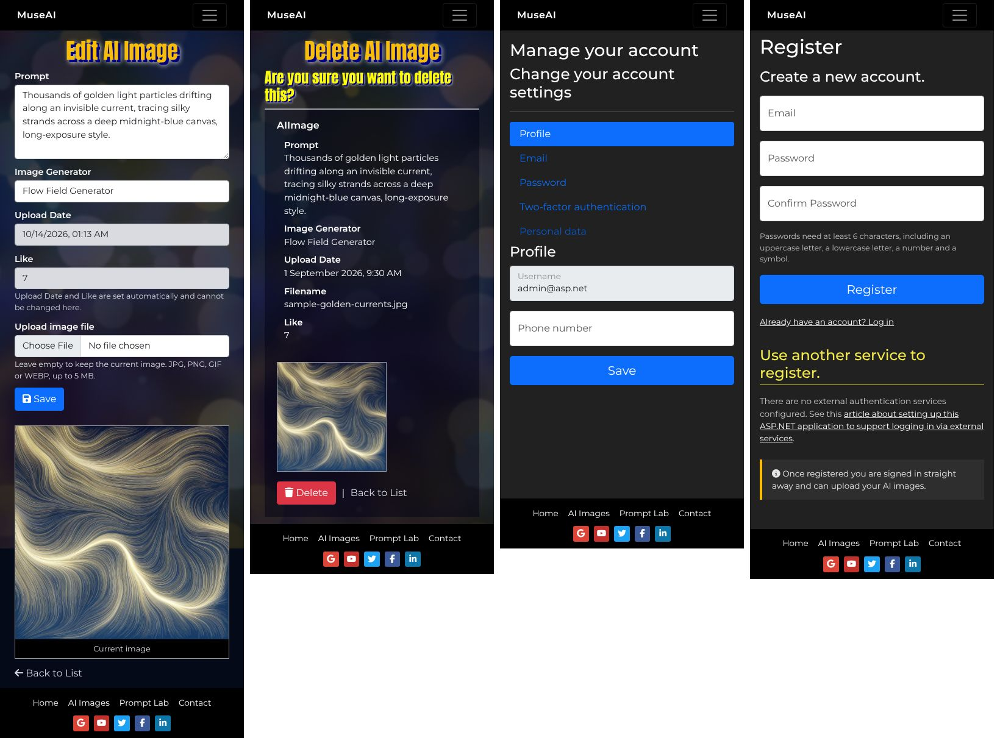

# MuseAI – AI in Creative Arts

**Web Design and Programming (7175) – Assessment 3**

MuseAI is a responsive ASP.NET Core MVC website about **AI in Creative Arts**: AI art generators, AI music
composition and AI creative writing. It includes a gallery of member-uploaded AI images that is backed by
Entity Framework Core, role-based access for visitors, members and admins, and an interactive **Prompt Lab**,
which is the additional creative page.


---

## 1. Running the site

**Visual Studio 2022:** open `AICreativeArts.sln` and press **F5**.

**Command line:**

```bash
cd AICreativeArts
dotnet run
```

The browser opens at `https://localhost:7113` (or `http://localhost:5280` with the `http` profile).

You do **not** need to run any database commands. On start-up the site:

1. applies the EF Core migrations, creating the SQLite database `app.db`;
2. creates the **Admin** role and the two test accounts below;
3. inserts six sample gallery images and copies their files to `wwwroot/uploads/`.

| Role | Email | Password | What they can do |
|---|---|---|---|
| Admin | `admin@asp.net` | `Admin@123` | Everything: upload, like, view details, edit, delete |
| Member | `member@asp.net` | `Member@123` | Browse, like (one like per image per login) and upload |
| Visitor | *(not logged in)* | – | Home pages, AI Images list (no buttons), Register, Login |

New users who register are signed in straight away as **members**.

> **Before submitting:** set your name and email in `AICreativeArts/appsettings.json`
> (`Site:DeveloperName` and `Site:ContactEmail`). They are shown on the Contact page.

Requirements: .NET 8 SDK, which is included with Visual Studio 2022 17.8 or later. No other software is needed.
SQLite is embedded, and the fonts and icons are self-hosted, so the site also works offline.

---

## 2. How the brief is met

| Brief requirement | Where / how |
|---|---|
| ASP.NET Core MVC (C#) | `AICreativeArts/` – controllers, models, Razor views, Identity |
| Full-width layout, no gaps | `body` is a flex column; `main` fills the space between the menu and the footer; edge-to-edge sections |
| `Views/Home/Index` + `Contact` | `HomeController` → `Views/Home/Index.cshtml`, `Views/Home/Contact.cshtml` |
| `Views/AIImages/` Create, Details, Delete, Edit, Index | `AIImagesController` + views. Create and Edit share `_ImageForm.cshtml` |
| `AIImage` model + Entity Framework | `Models/AIImage.cs`, `Data/ApplicationDbContext.cs`, `Data/Migrations/` |
| `_Layout.cshtml` with head, menu and footer | `Views/Shared/_Layout.cshtml` |
| Register and Login pages | `Areas/Identity/Pages/Account/Register` + `Login` (scaffolded and themed) |
| Additional creative page | **Prompt Lab** (`Views/Home/PromptLab.cshtml`): an AI art prompt builder and a creative-AI timeline, linked from the menu and the footer |
| Menu and footer links | Home, AI Images, Prompt Lab and Contact in both. The footer also has 5 Font Awesome icons |
| Visitor / Member / Admin access | `[AllowAnonymous]`, `[Authorize]` and `[Authorize(Roles = Roles.Admin)]` on each action (see section 3) |
| Bootstrap 5, Flexbox, Grid, media queries | Bootstrap 5 navbar, grid and forms; Flexbox (tiles, footer, actions); CSS Grid (feature blocks, gallery, list rows, Prompt Lab); breakpoints at 576px, 768px, 992px and 1200px |
| All CSS in external `site.css` | `wwwroot/css/site.css` (plus the Bootstrap and Font Awesome library files). There are no `style` attributes or `<style>` blocks |
| All JavaScript in external `site.js` | `wwwroot/js/site.js`. There are no internal `<script>` blocks or inline event handlers |
| Parallax scrolling | `background-attachment: fixed` on the hero and section backgrounds |
| Mouse over / mouse out (CSS + JS) | Tool tiles show researched text on mouse over. Gallery tiles fade their image in over 2s |
| JavaScript produces HTML5 elements | `site.js` builds the hover captions, the gallery `` elements, the repeating images on mobile and the saved-prompt list |
| Blocks appear only when fully in the viewport | An `IntersectionObserver` in `site.js` (`initRevealOnView`) |
| HTML5 anchor links | Gallery tiles link to `/AIImages#image-{id}`. After **Like**, the page returns to that block at the top |
| List sorted by likes (descending) | `AIImagesController.Index` and `UploadGalleryViewComponent` |
| Upload date and Like read-only | `readonly` inputs, and the server always sets both values itself |
| Images uploaded to `wwwroot/uploads/` | `Services/ImageStorage.cs` |
| Handle all exceptions | See section 5 |
| Same display on Chrome and Edge | Both are Chromium. Prefixed and standard properties are paired (e.g. `background-clip: text`) |
| Original or copyright-free media, credited | All images are original generative artworks made by `tools/generate_art.py`. All credits are on the Contact page |

---

## 3. Access rules

| Page | Visitor | Member | Admin |
|---|:-:|:-:|:-:|
| Home, Contact, Prompt Lab | ✅ | ✅ | ✅ |
| Register, Login | ✅ | ✅ | ✅ |
| AI Images list | ✅ (no buttons) | ✅ Like | ✅ Like, Edit, Delete |
| Create (upload) | → Login | ✅ | ✅ |
| Details, Edit, Delete | → Login | → Access Denied | ✅ |

The brief's accessibility list leaves the AI Images list out for visitors and members. However, its
screenshots show a visitor ("sees no button") and a member ("only sees the Like button") on that page, and the
home page tiles link to it. The list is therefore public, while every action on it is protected.

Visitors are redirected to Login and then returned to the page they asked for. Members are shown a themed
**Access Denied** page.

**Likes:** each logged-in user can like an image **once per login**. After logging out and back in, they can like
it again, exactly as the brief describes. The liked IDs are kept in the session, which is cleared on sign-in and
sign-out (`Services/LikeTracker.cs`). `canIncreaseLike` is calculated for each viewer, so it is `[NotMapped]`.

---

## 4. Back-end design

```
AICreativeArts/
├── Authorization/Roles.cs            role name constants
├── Content/                          researched copy and Prompt Lab data (kept out of the views)
├── Controllers/                      HomeController, AIImagesController
├── Data/                             DbContext, migrations, seed data, start-up initialiser
├── Filters/UploadSizeGuardAttribute  friendly handling of oversized uploads
├── Infrastructure/                   options classes, URL helpers
├── Models/                           AIImage, error view models
├── Services/                         ImageStorage (validation + files), SessionLikeTracker
├── TagHelpers/NavActiveTagHelper     highlights the current menu item (aria-current)
├── ViewComponents/UploadGallery      home page gallery tiles
├── ViewModels/AIImageFormViewModel   form model for Create/Edit (prevents over-posting)
└── Views/ + Areas/Identity/          Razor views and themed Identity pages
```

Highlights:

- **EF Core done properly.** Migrations are applied automatically. The column lengths and the sort index are
  configured in `OnModelCreating`, and the sample data is seeded with `HasData`.
- **Safe uploads.** Files are checked for size (5 MB), extension and real *file signature* (magic bytes), so a
  renamed `.exe` is rejected. They are stored under a generated name (`golden-canary-3f9a2c1b.jpg`), so a
  filename can never escape the uploads folder. A replaced or deleted image's file is removed from disk.
- **Over-posting protection.** A dedicated view model is used, and `UploadDate`, `Like` and `Filename` are
  always set on the server.
- **Atomic likes.** The like is a single `ExecuteUpdate` SQL statement, so simultaneous likes are never lost.
- **Security.** Every POST requires an antiforgery token (a global filter). Login and Register ignore external
  return URLs, which prevents open redirects. Accounts lock for 5 minutes after 5 failed logins. Security
  headers are sent with every response.
- **Razor features.** The site uses a layout, partial views, a view component, a custom tag helper,
  `@inject`ed options, tag helpers throughout, client-side validation, and TempData status toasts.

---

## 5. Exception handling

| Situation | Result |
|---|---|
| Any unhandled exception | A themed "Something went wrong" page (`UseExceptionHandler`) in every environment. The details are logged |
| Unknown URL, unknown or invalid id (`/AIImages/Edit/abc`) | A themed 404 page (`UseStatusCodePagesWithReExecute`) |
| Missing or invalid antiforgery token | A themed 400 page |
| GET on a POST-only action | A themed 405 page |
| No file, wrong type, fake image, file over 5 MB | A validation message on the form, checked both in the browser and on the server |
| Request over 10 MB | The user is redirected back to the form with a message (`UploadSizeGuardAttribute`) |
| Database or disk errors while saving or deleting | Caught. The user sees a message, and the half-saved files are cleaned up |
| Concurrent edit or delete | Handled (`DbUpdateConcurrencyException`) |
| Uploaded file missing from disk | `site.js` swaps in an "Image unavailable" placeholder |
| Database unreachable on the home page | The gallery shows a notice and the rest of the page still loads |
| `localStorage` or clipboard blocked (Prompt Lab) | A friendly message instead of a script error |

---

## 6. Responsive design

| Viewport | Layout |
|---|---|
| ≥ 768px | The values from the brief (e.g. main heading 7vw, block headings 4vw, square text 1.2vw). Text cards sit beside the two tiles. 6 gallery tiles per row. List rows alternate image left and right |
| 576–767px | The same menu. Blocks stack (as in the brief's screenshots), with larger font sizes from media queries. 3 gallery tiles per row. List images become a repeating band |
| < 576px | The menu collapses to a hamburger. Fonts grow again for readability. 2 gallery tiles per row. Forms are a single column, with the image below the form |

The site also respects `prefers-reduced-motion`, supports keyboard focus for the hover effects, and has a skip
link, `aria-*` labels and `alt` text throughout.

| Mobile | Mobile forms |
|---|---|
|  |  |

---

## 7. Tests

```bash
dotnet test
```

The suite has 74 automated tests (`AICreativeArts.Tests/`). Each run uses its own temporary database and upload
folder:

- **Access control:** the visitor, member and admin rules for every page, the login redirects, Access Denied and
  the friendly 404s.
- **Workflow:** liking (once per login, again after re-login), visitor and antiforgery rejection, sorting,
  uploading with over-posting attempts, fake-image rejection, and admin edit and delete.
- **Image storage:** signature checks, size limits, safe filenames and path-traversal protection.
- **Compliance:** every `.cshtml` file is scanned for `style` attributes, `<style>` blocks, internal `<script>`
  blocks and inline `on…` handlers. A further check confirms that the menu and footer link to every main page.

---

## 8. Media and credits

All images are **original procedural artworks created for this project**: the backgrounds, tool tiles, sample
gallery pieces, placeholders and favicon. No stock photos or product logos are used, and the tool tiles are
illustrations rather than company logos. To regenerate them:

```bash
pip install numpy pillow
python3 tools/generate_art.py
```

- **Fonts:** Anton, Montserrat, Lato, Oxygen and Niconne from Google Fonts (SIL Open Font License), self-hosted
  in `wwwroot/lib/fonts`.
- **Icons:** Font Awesome Free 6.7 (CC BY 4.0 / OFL / MIT), self-hosted in `wwwroot/lib/fontawesome`.
- **Text:** written in my own words from the Wikipedia articles and official websites listed on the Contact page.

---

## 9. Switching to SQL Server LocalDB (optional)

SQLite was chosen so that the project runs anywhere with zero set-up. To use LocalDB instead:

1. Replace the `Microsoft.EntityFrameworkCore.Sqlite` package with `Microsoft.EntityFrameworkCore.SqlServer`.
2. Change `UseSqlite` to `UseSqlServer` in `Program.cs`.
3. Set the connection string to `Server=(localdb)\\mssqllocaldb;Database=MuseAI;Trusted_Connection=True;MultipleActiveResultSets=true`.
4. Delete `Data/Migrations` and run `Add-Migration Initial`. The database is created on the next run.
