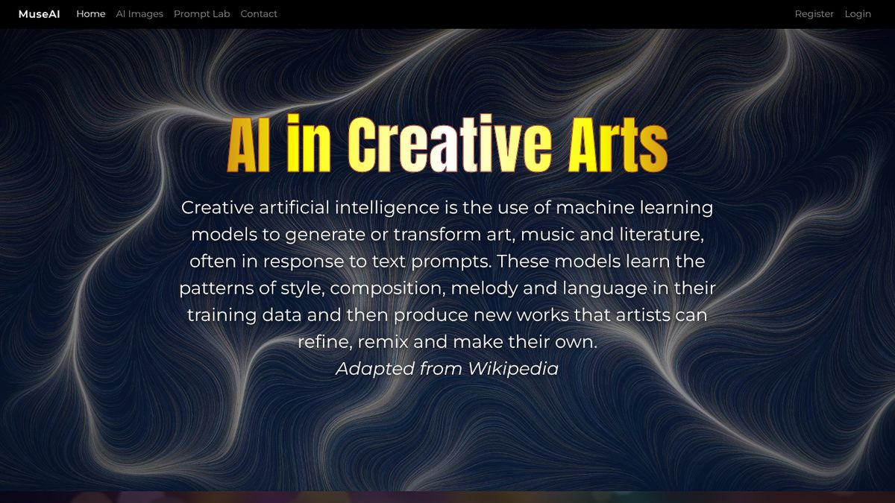
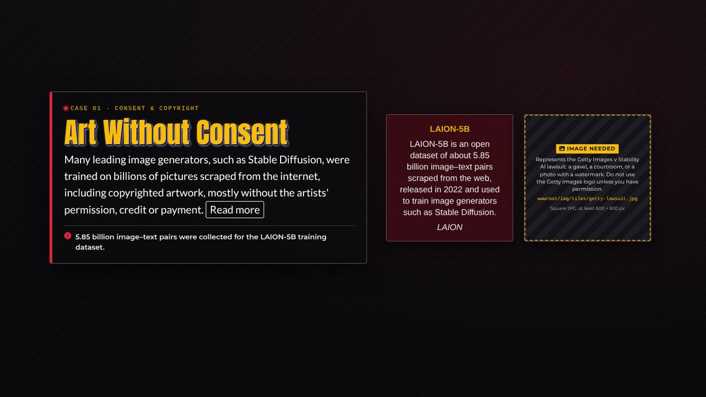
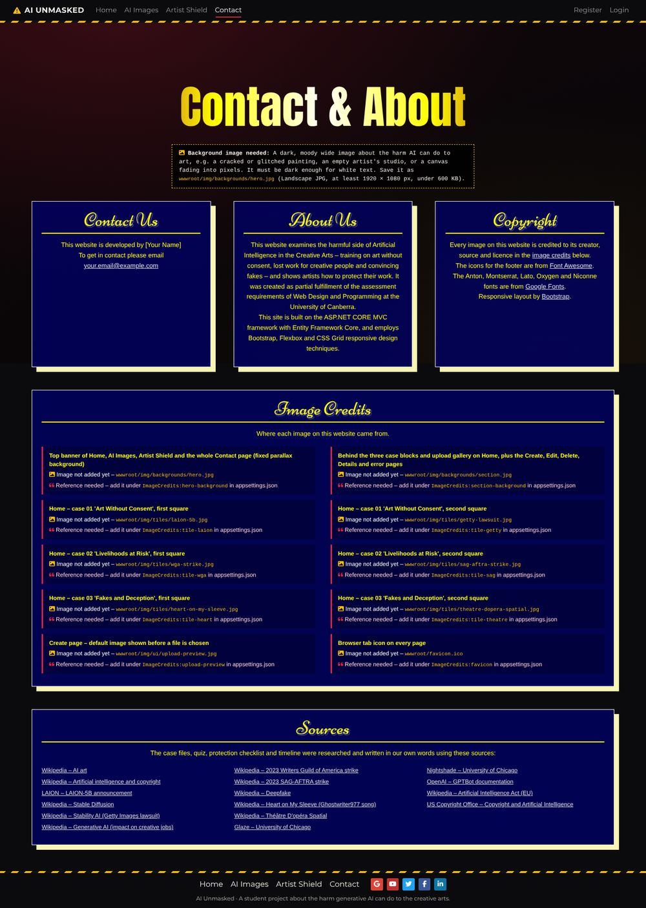
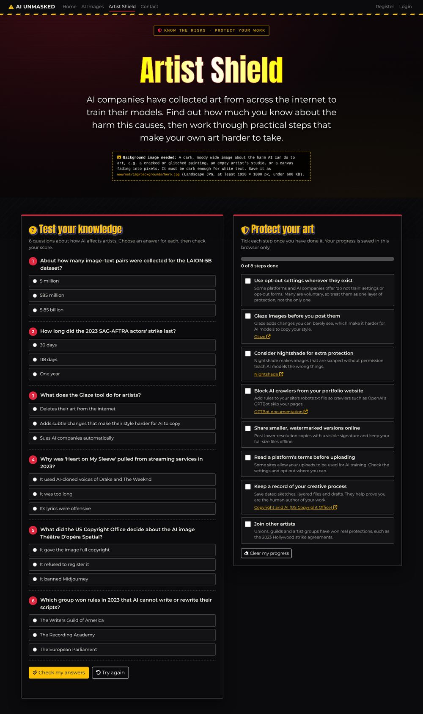
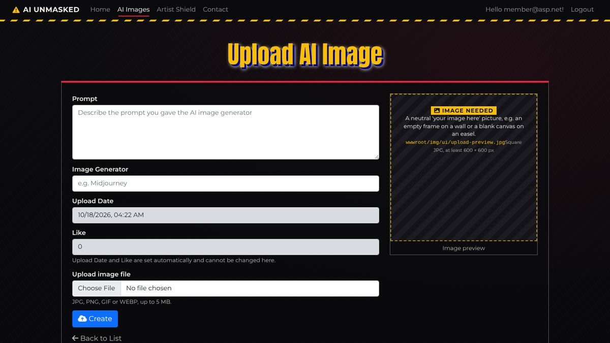
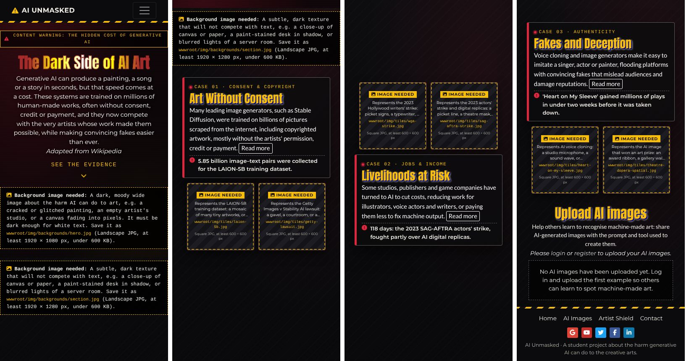

# Front-end and views reference

This document explains everything that **AI Unmasked** sends to the browser. It covers every Razor view, partial view and Identity page: the URL that shows it, the model it receives, what it renders, which partials, tag helpers and view components it uses, and which part of the assessment brief it meets. It then walks through the stylesheet `wwwroot/css/site.css` section by section, and the script `wwwroot/js/site.js` function by function. After that come a table of how every page changes at each screen width, the accessibility features, proof that the brief's "external CSS and JavaScript only" rules are met, and the third-party libraries in `wwwroot/lib`. It is written for you, the owner of the project, so each idea is explained the first time it appears. Every file path, class name, selector, value and message below was copied from the code. If you change the code, please update this document as well.

Related documents: [../DOCUMENTATION.md](../DOCUMENTATION.md) (overview), [02-back-end.md](02-back-end.md) (C# code, controllers, database, tests), [04-images-content-and-references.md](04-images-content-and-references.md) (adding images, credits and text), [05-vscode-guide.md](05-vscode-guide.md) (VS Code and moving into a new ASP.NET Core Web App).

## Contents

1. [At a glance](#1-at-a-glance)
2. [Razor set-up files](#2-razor-set-up-files)
3. [The layout and shared views](#3-the-layout-and-shared-views)
4. [Home views](#4-home-views)
5. [AI Images views](#5-ai-images-views)
6. [Identity pages](#6-identity-pages)
7. [site.css, section by section](#7-sitecss-section-by-section)
8. [site.js, function by function](#8-sitejs-function-by-function)
9. [Responsive design: breakpoints and what changes](#9-responsive-design-breakpoints-and-what-changes)
10. [Accessibility](#10-accessibility)
11. [Proof that the brief's CSS and JavaScript rules are met](#11-proof-that-the-briefs-css-and-javascript-rules-are-met)
12. [Third-party front-end libraries (wwwroot/lib)](#12-third-party-front-end-libraries-wwwrootlib)
13. [Common front-end changes](#13-common-front-end-changes)

---

## 1. At a glance

### 1.1 Folder map (front-end files only)

```text
AICreativeArts/
├── Views/
│   ├── _ViewImports.cshtml                  namespaces and tag helpers for every view
│   ├── _ViewStart.cshtml                    every view uses _Layout
│   ├── Home/
│   │   ├── Index.cshtml                     Home page (/)
│   │   ├── _FeatureSection.cshtml           one "case file" block
│   │   ├── _FeatureCard.cshtml              the text card of a block
│   │   ├── _CaseTiles.cshtml                the two square tiles of a block
│   │   ├── Contact.cshtml                   Contact & About
│   │   ├── ArtistShield.cshtml              the additional creative page
│   │   └── Status.cshtml                    friendly page for 4xx/5xx errors
│   ├── AIImages/
│   │   ├── Index.cshtml                     List of AI Images
│   │   ├── Create.cshtml  Edit.cshtml       upload / edit pages
│   │   ├── _ImageForm.cshtml                form shared by Create and Edit
│   │   ├── Details.cshtml  Delete.cshtml    admin pages
│   │   └── _ImageDetails.cshtml             field list shared by Details and Delete
│   └── Shared/
│       ├── _Layout.cshtml                   <head>, menu, footer and scripts for every page
│       ├── _LoginPartial.cshtml             Register/Login, or Hello …!/Logout
│       ├── _SiteToasts.cshtml               success and error messages
│       ├── _UploadCallToAction.cshtml       "Please login or register…" / "Click here to upload…"
│       ├── _ValidationScriptsPartial.cshtml jQuery Validation script tags
│       ├── Error.cshtml                     page shown after an unhandled exception
│       └── Components/UploadGallery/Default.cshtml   gallery tiles on the Home page
├── Areas/Identity/Pages/
│   ├── _ViewImports.cshtml  _ViewStart.cshtml
│   └── Account/
│       ├── _ViewImports.cshtml
│       ├── Login.cshtml  Register.cshtml  AccessDenied.cshtml   (+ .cshtml.cs page models)
└── wwwroot/
    ├── css/site.css                         every style written for this site
    ├── js/site.js                           every script written for this site
    ├── img/                                 image slots (empty until you add files) + README.md
    ├── uploads/                             images uploaded through the Create and Edit forms
    └── lib/                                 Bootstrap, jQuery, jQuery Validation, Font Awesome, fonts
```

### 1.2 How a page is put together

```text
Controller action (e.g. HomeController.Index)  or  Razor Page (e.g. Identity Login)
   │
   ▼
View (e.g. Views/Home/Index.cshtml)
   • sets ViewData["Title"], ViewData["BodyClass"] and sometimes ViewData["Description"]
   • <partial name="…" />               reuses a piece of markup (a partial view)
   • @await Component.InvokeAsync(…)     a view component that runs its own database query
   • tag helpers                          asp-* attributes, <image-slot>, <background-slot-note>, nav-active
   │
   ▼  _ViewStart.cshtml says: wrap the result in _Layout.cshtml
_Layout.cshtml
   <head> CSS links · skip link · <header> menu · <main> toasts + the view · <footer> · <script> tags (site.js last)
   │
   ▼
Browser: site.css styles the page; when the HTML is ready, site.js adds the interactive parts.
```

### 1.3 ViewData keys and body classes

Each view sets a few `ViewData` values that `_Layout.cshtml` reads:

| Key | Used for | Default when not set |
|---|---|---|
| `ViewData["Title"]` | `<title>` becomes "*Title* - AI Unmasked" | (empty) |
| `ViewData["BodyClass"]` | class on `<body>`, which `site.css` uses to pick the page background | `page-default` |
| `ViewData["Description"]` | `<meta name="description">` for search engines | a general description of the site |

| Body class | Set by | What `site.css` does with it |
|---|---|---|
| `page-home` | `Views/Home/Index.cshtml` | nothing of its own (a hook you can style later) |
| `page-contact` | `Views/Home/Contact.cshtml` | the whole `<main>` gets the fixed **hero** background |
| `page-shield` | `Views/Home/ArtistShield.cshtml` | nothing of its own (a hook) |
| `page-list` | `Views/AIImages/Index.cshtml` | `<main>` gets the fixed **section** background |
| `page-form` | AIImages `Create`, `Edit`, `Details`, `Delete` | `<main>` gets the fixed **section** background |
| `page-message` | `Shared/Error`, `Home/Status`, Identity `AccessDenied` | `<main>` gets the fixed **section** background |
| `page-account` | Identity `Login`, `Register` | plain dark-grey `<main>` |
| `page-default` | any page that sets no body class: the built-in Identity pages (Manage, Logout, Lockout, ForgotPassword …) | dark-grey `<main>` with padding |
| `has-hero-image` | `_Layout.cshtml`, only when `wwwroot/img/backgrounds/hero.jpg` exists | switches on the hero background photo |
| `has-section-image` | `_Layout.cshtml`, only when `wwwroot/img/backgrounds/section.jpg` exists | switches on the section background photo |

The last two are explained in [7.4 How the background image slots work](#74-how-the-background-image-slots-work).

### 1.4 Every page: URL, view, model and who can open it

| URL | View file | Model | Who can open it |
|---|---|---|---|
| `/` (also `/Home`, `/Home/Index`) | `Views/Home/Index.cshtml` | none (text comes from `Content/SiteContent.cs`) | everyone |
| `/Home/Contact` | `Views/Home/Contact.cshtml` | `SiteOptions` | everyone |
| `/Home/ArtistShield` | `Views/Home/ArtistShield.cshtml` | none (text comes from `Content/ArtistShieldContent.cs`) | everyone |
| `/AIImages` | `Views/AIImages/Index.cshtml` | `IEnumerable<AIImage>` | everyone (the buttons depend on the role) |
| `/AIImages/Create` | `Views/AIImages/Create.cshtml` | `AIImageFormViewModel` | members and admins |
| `/AIImages/Edit/{id}` | `Views/AIImages/Edit.cshtml` | `AIImageFormViewModel` | admins |
| `/AIImages/Details/{id}` | `Views/AIImages/Details.cshtml` | `AIImage` | admins |
| `/AIImages/Delete/{id}` | `Views/AIImages/Delete.cshtml` | `AIImage` | admins |
| `/Identity/Account/Login` | `Areas/Identity/Pages/Account/Login.cshtml` | `LoginModel` | everyone (signed-in users are sent on) |
| `/Identity/Account/Register` | `Areas/Identity/Pages/Account/Register.cshtml` | `RegisterModel` | everyone (signed-in users are sent on) |
| `/Identity/Account/AccessDenied` | `Areas/Identity/Pages/Account/AccessDenied.cshtml` | `AccessDeniedModel` | shown when a member opens an admin page |
| `/Home/Error` (run by the exception handler) | `Views/Shared/Error.cshtml` | `ErrorViewModel` | shown after an unhandled exception |
| `/Home/Status?code=…` (run by the status-code handler) | `Views/Home/Status.cshtml` | `StatusCodeViewModel` | shown for 400–599 responses to page requests |

A visitor who opens a page for members or admins is sent to the Login page first. The full access-control matrix is in [02-back-end.md section 4](02-back-end.md#4-roles-and-the-access-control-matrix).

---

## 2. Razor set-up files

These files contain no visible markup. They configure every view in their folder and the folders below it.

| File | What it does |
|---|---|
| `Views/_ViewImports.cshtml` | Adds `@using` lines for `AICreativeArts`, `.Authorization`, `.Content`, `.Infrastructure`, `.Models`, `.ViewComponents` and `.ViewModels`. That is why views can write `SiteContent.Sections`, `ImageLibrary.HeroBackground`, `Roles.Admin` or `Url.ImageAnchor(...)` without namespaces. `@addTagHelper *, Microsoft.AspNetCore.Mvc.TagHelpers` turns on the built-in `asp-*` tag helpers, and `@addTagHelper *, AICreativeArts` turns on this project's own tag helpers (`<image-slot>`, `<background-slot-note>`, `nav-active`). |
| `Views/_ViewStart.cshtml` | `Layout = "_Layout";`, so every MVC view is wrapped in `Views/Shared/_Layout.cshtml`. |
| `Areas/Identity/Pages/_ViewImports.cshtml` | `@using Microsoft.AspNetCore.Identity`, `AICreativeArts` and `AICreativeArts.Areas.Identity.Pages`, plus the same two `@addTagHelper` lines. |
| `Areas/Identity/Pages/Account/_ViewImports.cshtml` | `@using AICreativeArts.Areas.Identity.Pages.Account`, so `@model LoginModel` (and the others) can be found. |
| `Areas/Identity/Pages/_ViewStart.cshtml` | `Layout = "/Views/Shared/_Layout.cshtml";`, so every Identity page uses the site's menu and footer. This includes the built-in pages from the Identity UI package. |

---

## 3. The layout and shared views

### 3.1 `Views/Shared/_Layout.cshtml`: the frame around every page

**Brief:** Requirement 2 (`_Layout.cshtml` provides the head, menu and footer), Requirement 3 (the menu and footer link to Index, AIImages and Contact), the creative page "linked from both the menu and the footer", the footer's "5 icons using Font Awesome", Requirement 1 (full width) and Requirements 6–7 (external CSS and JavaScript).

It injects `IMediaLibrary` as `Media` (`@inject AICreativeArts.Services.IMediaLibrary Media`), so it can ask whether an image file has been added yet.

**`<head>`**

| Element | Purpose |
|---|---|
| `<meta charset>` and `<meta name="viewport" content="width=device-width, initial-scale=1.0">` | Correct characters, and phones use their real width (needed for media queries) |
| `<meta name="description">` | `ViewData["Description"]`, or a general sentence about the site |
| `<meta name="theme-color" content="#0b0b0d">` | Colours the browser bar on mobile to match the site |
| `<title>@ViewData["Title"] - AI Unmasked</title>` | Tab title |
| `<link rel="icon" href="~/favicon.ico" asp-append-version="true">` | Only output when the `favicon` image slot file exists (`Media.HasFile(ImageLibrary.Favicon)`), so the browser never asks for a missing icon |
| Two `<link rel="preload" … as="font">` | Start downloading Anton and Montserrat 400 early, because the first screen uses them |
| Five stylesheets, in this order | `lib/bootstrap/dist/css/bootstrap.min.css`, `lib/fontawesome/css/fontawesome.min.css`, `brands.min.css`, `solid.min.css`, then `css/site.css`. `site.css` comes **last** so its rules can override Bootstrap's. `asp-append-version="true"` adds `?v=<hash>` to the URL, so browsers download the file again whenever you change it |

**Background classes.** A Razor code block builds `backgroundClasses`. It adds `has-hero-image` when `ImageLibrary.HeroBackground` has a file and `has-section-image` when `ImageLibrary.SectionBackground` has one. `<body class="@(ViewData["BodyClass"] ?? "page-default") @backgroundClasses">` then carries both the page class and these classes.

**Body, top to bottom**

1. `<a class="skip-link" href="#main-content">Skip to main content</a>`: the first thing a keyboard user reaches (see [section 10](#10-accessibility)).
2. `<header class="site-header">` containing a Bootstrap navbar, `<nav class="navbar navbar-expand-sm navbar-dark site-navbar" aria-label="Main">`:
   - `container-fluid` (full width, no side margins).
   - Brand link to Home: a Font Awesome warning triangle (`fa-triangle-exclamation brand-icon`) and `<span class="brand-text">AI Unmasked</span>`. Like the sample's "GenAI" and "Home", both the brand and the **Home** item link to the home page. (The `data-text="AI Unmasked"` attribute on the span is not read by `site.css` or `site.js`.)
   - `navbar-toggler` button (`data-bs-toggle="collapse" data-bs-target="#main-menu"`, with `aria-controls`, `aria-expanded` and `aria-label="Toggle navigation"`). Bootstrap only shows it below 576 px.
   - `<div class="collapse navbar-collapse" id="main-menu">` with `<ul class="navbar-nav me-auto">`: **Home**, **AI Images**, **Artist Shield**, **Contact**. Each link has a `nav-active` attribute (`Home/Index`, `AIImages/*`, `Home/ArtistShield`, `Home/Contact`). The `NavActiveTagHelper` adds `class="active"` and `aria-current="page"` to the current page's link.
   - `<partial name="_LoginPartial" />` (right-hand account links).
3. `<main id="main-content" class="site-main" tabindex="-1">` holds `<partial name="_SiteToasts" />` and then `@RenderBody()` (the view). There is **no** Bootstrap `.container` around `RenderBody()`, unlike the default template. That keeps every page full width, with no gaps (Requirement 1).
4. `<footer class="site-footer">` contains `<nav class="footer-nav" aria-label="Footer">` with two lists:
   - `ul.footer-links`: Home, AI Images, Artist Shield, Contact (the same links as the menu).
   - `ul.social-links`: five Font Awesome brand icons. These are `fa-google` (Google Arts & Culture), `fa-youtube`, `fa-twitter` (X), `fa-facebook-f` and `fa-linkedin-in`. Each link has `target="_blank" rel="noopener noreferrer"` and an `aria-label` that ends "(opens in a new tab)". The icons are `aria-hidden="true"`.
   - `p.footer-note`: "AI Unmasked · A student project about the harm generative AI can do to the creative arts."
5. Scripts, at the end of `<body>`, in this order: `lib/jquery/dist/jquery.min.js`, `lib/bootstrap/dist/js/bootstrap.bundle.min.js`, `@await RenderSectionAsync("Scripts", required: false)` (pages with forms put their validation scripts here), and finally `js/site.js` with `asp-append-version="true"`. `site.js` is last so that Bootstrap (used by `initToasts`) and jQuery Validation (used by `initUploadForm`) are already loaded.

**Tag helpers used:** `asp-area`/`asp-controller`/`asp-action` (build the link URLs), `asp-append-version`, `nav-active` (custom) and `<partial>`.

### 3.2 `Views/Shared/_LoginPartial.cshtml`: account links in the menu

It injects `SignInManager<IdentityUser>` and renders `<ul class="navbar-nav navbar-account">`.

| Visitor sees | Signed-in user sees |
|---|---|
| **Register** → `/Identity/Account/Register` | **Hello *email*!** → `/Identity/Account/Manage` (`asp-page="/Account/Manage/Index"`, title "Manage your account"). Admins also see `<span class="role-badge">Admin</span>` (`User.IsInRole(Roles.Admin)`) |
| **Login** → `/Identity/Account/Login` | **Logout**: a `<form class="logout-form" method="post">` that posts to `/Identity/Account/Logout` with `returnUrl` set to the home page. The button is styled as a link (`nav-link btn btn-link`) |

Logout is a POST form, not a link, so another website cannot log your users out by tricking the browser into opening a URL. The form tag helper adds the antiforgery token automatically. **Brief:** the Register and Login links on the menu (brief page 9).

### 3.3 `Views/Shared/_SiteToasts.cshtml`: status messages

It reads `TempData["SiteMessage"]` and `TempData["SiteError"]`, which controllers set just before a redirect. Examples are "Thanks! Your Midjourney image has been uploaded.", "The image has been updated." and "The image could not be deleted. Please try again.". `TempData` survives exactly one redirect, so a message appears once, on the next page.

The partial outputs nothing when both are empty. Otherwise it renders:

```html
<div class="toast-stack" aria-live="polite" aria-atomic="true">
  <div class="toast show site-toast site-toast--success" role="status">   <!-- or site-toast--error, role="alert" -->
    <div class="toast-body">
      <i class="fa-solid fa-circle-check" aria-hidden="true"></i>          <!-- fa-triangle-exclamation for errors -->
      <span>message</span>
      <button type="button" class="btn-close btn-close-white" data-bs-dismiss="toast" aria-label="Close"></button>
    </div>
  </div>
</div>
```

`toast show` makes the message visible without JavaScript. `initToasts` in `site.js` hides it after 7 seconds. **Brief:** supports Requirement 8 by reporting problems in plain language instead of crashing.

### 3.4 `Views/Shared/_UploadCallToAction.cshtml`: the upload sentence

It is used on the Home page (upload section) and at the top of the AI Images list.

- **Signed in:** `<p class="upload-cta"><a href="/AIImages/Create">Click here to upload a new AI image</a></p>`
- **Visitor:** "Please **login** or **register** to upload your AI images." Both links carry `returnUrl=/AIImages/Create`, so after logging in or registering the user lands straight on the upload form.

**Brief:** pages 9–10 ("Please login or register to upload your AI images" changes to "Click here to upload a new AI image").

### 3.5 `Views/Shared/_ValidationScriptsPartial.cshtml`

It contains two `<script src>` tags: `lib/jquery-validation/dist/jquery.validate.min.js` and `lib/jquery-validation-unobtrusive/jquery.validate.unobtrusive.min.js`. `Create`, `Edit`, `Login` and `Register` include it through `@section Scripts { <partial name="_ValidationScriptsPartial" /> }`. It switches on **client-side validation**. The `asp-for` tag helpers turn the model's `[Required]`/`[StringLength]` attributes into `data-val-*` attributes, for example `data-val-required="Please enter the prompt used to generate the image."`, and these scripts read them and show the messages before the form is sent. The server checks everything again anyway.

### 3.6 `Views/Shared/Error.cshtml`: unhandled exceptions

| | |
|---|---|
| **Shown when** | Any unhandled exception: `UseExceptionHandler("/Home/Error")` re-runs the request as `HomeController.Error` |
| **Model** | `ErrorViewModel` (`RequestId`, `ShowRequestId`) |
| **ViewData** | Title "Something went wrong", BodyClass `page-message` |
| **Renders** | `section.message-page` > `div.message-card` with a palette icon, `<h1 class="form-heading">Oops! Something went wrong</h1>`, an apology, "Reference: `<code>RequestId</code>`" (when there is one), and two buttons: **Back to Home** (`btn-warning`) and **Browse AI Images** (`btn-outline-light`) |
| **Brief** | Requirement 8 (handle all exceptions) |

### 3.7 `Views/Shared/Components/UploadGallery/Default.cshtml`: the Home page gallery

| | |
|---|---|
| **Rendered by** | `@await Component.InvokeAsync("UploadGallery")` in `Views/Home/Index.cshtml` |
| **Model** | `UploadGalleryViewModel(Images, TotalCount, Unavailable)` from `UploadGalleryViewComponent`, which loads up to 24 images (`maxItems = 24`), sorted by most likes and then newest |
| **Brief** | The "Upload AI Images" block that always appears, "Maximum number of blocks per row is 6", list sorted by likes (highest first), and "If the user clicks on this block, the user is redirected to the block … on the AI Images page using an anchor link" |

It has three states:

1. `Model.Unavailable` (the database could not be read): `<p class="gallery-notice">The gallery is taking a short break. Please refresh the page in a moment.</p>`.
2. No images: `<p class="gallery-notice">No AI images have been uploaded yet. Log in and upload the first example so others can learn to spot machine-made art.</p>`.
3. Otherwise a grid:

```html
<ul class="upload-grid">
  <li class="upload-grid-item">
    <a class="upload-tile" href="/AIImages#image-3" data-image="/uploads/golden-canary-3f9a2c1b.jpg">
      <span class="upload-tile-label">Midjourney</span>
      <span class="visually-hidden">: prompt text (2 likes). View it on the AI Images page.</span>
    </a>
  </li>
  …
</ul>
```

`href` comes from `Url.ImageAnchor(id)` and `data-image` from `Url.UploadedImage(filename)`, both in `Infrastructure/SiteUrlExtensions.cs`. There is deliberately **no `` in the HTML**. `initUploadTiles` in `site.js` creates it, which meets the brief's "JavaScript to produce HTML5 elements". When there are more images than tiles (`TotalCount > Images.Count`), a `p.gallery-more` link says "See all *N* AI images".

---

## 4. Home views

### 4.1 `Views/Home/Index.cshtml`: Home page

| | |
|---|---|
| **URL** | `/` (`HomeController.Index`) |
| **Model** | none. Text comes from the static class `Content/SiteContent.cs` |
| **ViewData** | Title "The Dark Side of AI Art", BodyClass `page-home` |
| **Partials, components and tag helpers** | `_FeatureSection` (×3), `_UploadCallToAction`, `UploadGallery` view component, `<background-slot-note>` (×2) |



**Structure**

1. `<section class="hero hero--home" aria-labelledby="hero-title">`, the full-screen banner with the fixed hero background:
   - `p.hero-eyebrow`: a warning icon and `SiteContent.HeroEyebrow` ("Content warning: the hidden cost of generative AI").
   - `<h1 id="hero-title" class="hero-title hero-title--stroked">` = `SiteContent.HeroTitle` ("The Dark Side of AI Art").
   - `p.hero-text` = `SiteContent.HeroText`, then `<br /><em><a class="hero-source">Adapted from Wikipedia</a></em>`. This follows the brief's sample text, which ends `<br><em>Wikipedia</em>`.
   - `<a class="scroll-cue" href="#art-without-consent">` with "See the evidence" and a bouncing chevron. It is an HTML5 anchor link to the first block (`SiteContent.Sections[0].Id`).
   - `<background-slot-note key="@ImageLibrary.HeroBackground" />`: a dashed note describing the hero image to add. It disappears once the file exists.
2. `<div class="parallax-section">`, the area with the fixed section background:
   - `<background-slot-note key="@ImageLibrary.SectionBackground" />`.
   - `<h2 class="visually-hidden">Three case files: how AI harms the creative arts</h2>`. The brief asks for `h3` block headings, and this hidden `h2` keeps the heading order correct for screen readers.
   - `@foreach (var section in SiteContent.Sections)` renders `<partial name="_FeatureSection" model="section" />`.
   - `<section id="upload-ai-images" class="upload-section">` with `<h2 class="upload-title">Upload AI images</h2>`, `p.upload-intro`, `<partial name="_UploadCallToAction" />` and `@await Component.InvokeAsync("UploadGallery")`. After a successful upload, `AIImagesController.Create` redirects to `/#upload-ai-images`, so the user sees their new tile.

**How the Home page meets the brief**

| Brief (Home page) | Where |
|---|---|
| Main heading and text CSS | `.hero-title`, `.hero-title--stroked` and `.hero-text` in `site.css` section 6 |
| Parallax scrolling with fixed background images | `.hero` and `.parallax-section` use `background-attachment: fixed` (site.css section 3) |
| Three blocks that appear only when fully in the viewport | `.feature-row.reveal-on-view` + `initRevealOnView` |
| Mouse over / mouse out with CSS3 and JavaScript | `.tool-tile:hover` (CSS) + `bindHover` (`mouseover`/`mouseout`) in `initToolTiles` and `initUploadTiles` |
| JavaScript produces HTML5 elements | `initToolTiles` builds the caption `<span>`s, `initUploadTiles` builds the gallery ``s |
| HTML5 anchor hyperlinks | the scroll cue (`#art-without-consent`) and the gallery tiles (`/AIImages#image-N`) |
| Bootstrap 5, Flexbox, Grid, media queries | Bootstrap navbar; flex `.tool-tiles`; grid `.feature-row` and `.upload-grid`; site.css section 18 |
| The Upload AI Images block always appears; only logged-in users can upload | `.upload-section` has no `reveal-on-view` class; `_UploadCallToAction` |

### 4.2 `Views/Home/_FeatureSection.cshtml`: one case-file block

**Model:** `FeatureSection` (`Content/FeatureSection.cs`).

```html
<section id="art-without-consent" class="feature-section" aria-labelledby="art-without-consent-title">
  <div class="feature-row reveal-on-view feature-row--text-first">   <!-- or feature-row--tiles-first -->
    _FeatureCard then _CaseTiles   (reversed when TextFirst is false)
  </div>
</section>
```

When `Model.TextFirst` is `true` the card comes first in the HTML. When it is `false`, the tiles come first. The **HTML order matches the desktop layout**, so on phones (one column) the blocks stack in the same order as the sample design. `reveal-on-view` is the class that `initRevealOnView` watches.

The three blocks, from `SiteContent.Sections`:

| `Id` | Case label | Title | `TextFirst` | Tiles (image slot key) |
|---|---|---|---|---|
| `art-without-consent` | Case 01 · Consent & copyright | Art Without Consent | `true` | LAION-5B (`tile-laion`), Getty Images v Stability AI (`tile-getty`) |
| `livelihoods-at-risk` | Case 02 · Jobs & income | Livelihoods at Risk | `false` | 2023 Writers Guild of America strike (`tile-wga`), 2023 SAG-AFTRA strike (`tile-sag`) |
| `fakes-and-deception` | Case 03 · Authenticity | Fakes and Deception | `true` | Heart on My Sleeve (`tile-heart`), Théâtre D'opéra Spatial (`tile-theatre`) |

Like the sample's three blocks, the layout alternates: text first, tiles first, text first.

### 4.3 `Views/Home/_FeatureCard.cshtml`: the text card

**Model:** `FeatureSection`. It renders `div.feature-card` containing:

- `p.case-label`: for example "Case 01 · Consent & copyright".
- `<h3 id="{Id}-title" class="feature-title">`: the block heading. The `id` is what the section's `aria-labelledby` points to.
- `p.feature-text`: the description, then `<a class="read-more" target="_blank" rel="noopener noreferrer">Read more<span class="visually-hidden"> about {Title} (opens in a new tab)</span></a>`.
- `p.key-fact`: a red exclamation icon and one striking fact.

**Brief:** the block heading (`h3`, Anton, `#f8bd08`, 4vw, shadows), the block text (`p`, Lato, white, 1.5vw) and the "Read more" links.



### 4.4 `Views/Home/_CaseTiles.cshtml`: the two square tiles

**Model:** `IReadOnlyList<CaseExample>`.

```html
<div class="tool-tiles">
  <a class="tool-tile" href="https://laion.ai/blog/laion-5b/" target="_blank" rel="noopener noreferrer"
     data-hover-title="LAION-5B" data-hover-text="LAION-5B is an open dataset…" data-hover-source="LAION"
     aria-label="LAION-5B: LAION-5B is an open dataset… (LAION). Opens the source in a new tab.">
    <image-slot key="tile-laion" class="tool-tile-image" />
  </a>
  …
</div>
```

- `<image-slot>` becomes an `` when the slot's file exists, or a placeholder `<span>` that describes the picture to add (see [7.10](#710-section-7b-image-placeholders)).
- The three `data-hover-*` attributes hold the mouse-over caption. `initToolTiles` turns them into a caption overlay. The brief's sample captions end with "`<br>`Wikipedia", and here the source is shown on its own line.
- A click opens the external source in a new tab, as the brief asks ("hyperlink to external web page for mouse click").
- The `aria-label` repeats the caption, because the overlay itself is hidden from screen readers.

### 4.5 `Views/Home/Contact.cshtml`: Contact & About

| | |
|---|---|
| **URL** | `/Home/Contact` (`HomeController.Contact`) |
| **Model** | `SiteOptions` (`DeveloperName`, `ContactEmail` from the `"Site"` section of `appsettings.json`) |
| **Also uses** | `@inject IMediaLibrary Media`; `var slots = Media.All();` (every image slot with its file status and credit), `SiteContent.TextSources` |
| **ViewData** | Title "Contact & About", BodyClass `page-contact`, a Description |
| **Brief** | Contact page: heading like Home but without the stroke, three Bootstrap columns, `h1` sub-headings (Niconne, yellow), yellow Arial text; Requirement 11 (credit every source); the Copyright links |



**Structure**

1. `<section class="hero hero--contact">` > `<h1 class="hero-title">Contact &amp; About</h1>`. There is no `hero-title--stroked`, because the brief says the stroke is not used on this page. It also holds `<background-slot-note key="@ImageLibrary.HeroBackground" />`.
2. `div.container-fluid.contact-container` > `div.row.g-4.g-xl-5.contact-row` with three `div.col-12.col-md-4.d-flex` columns. Each column holds a `section.contact-card` with an `<h1 class="contact-heading">`:
   - **Contact Us**: "This website is developed by `@Model.DeveloperName`", then "To get in contact please email" and a `mailto:` link to `@Model.ContactEmail`.
   - **About Us**: what the site is about, "created as partial fulfillment of the assessment requirements of Web Design and Programming at the University of Canberra", and the technologies used.
   - **Copyright**: a link to `#image-credits` (an anchor further down), Font Awesome, Google Fonts (Anton, Montserrat, Lato, Oxygen, Niconne) and Bootstrap, each linked.
   - `d-flex` on the column and `width: 100%` on `.contact-card` make the three cards the same height.
3. `<section id="image-credits" class="contact-card credits-card">` with heading **Image Credits** and `ul.credits-list`. There is one `li.credit-item` per image slot (10 in total), with `credit-item--missing` added when the file is missing:
   - `span.credit-where`: where the image is used (`Slot.UsedOn`).
   - If the file is missing: `span.credit-status.credit-status--missing` "Image not added yet – `wwwroot/<file>`".
   - If the credit is complete (`Creator` and `Source` filled in): `span.credit-text` "*Creator*, *Source* (*Licence*)", plus a **View original** link when `Url` is a valid http(s) address.
   - Otherwise: `span.credit-status.credit-status--reference` "Reference needed – add it under `ImageCredits:<key>` in appsettings.json".
4. `section.contact-card.sources-card` with heading **Sources** and `ul.sources-list`: every text source in `SiteContent.TextSources` (16 links).

### 4.6 `Views/Home/ArtistShield.cshtml`: the additional creative page

| | |
|---|---|
| **URL** | `/Home/ArtistShield` (`HomeController.ArtistShield`) |
| **Model** | none. Data comes from `Content/ArtistShieldContent.cs`: `Quiz` (6 questions), `Steps` (8 steps) and `Timeline` (9 entries) |
| **ViewData** | Title "Artist Shield", BodyClass `page-shield`, a Description; `stepCount = ArtistShieldContent.Steps.Count` |
| **Brief** | "One additional creative page": responsive ([section 9](#9-responsive-design-breakpoints-and-what-changes)), only external CSS and JS ([section 11](#11-proof-that-the-briefs-css-and-javascript-rules-are-met)), linked from both the menu and the footer (`_Layout`), and the same look as the rest of the site (same hero, heading styles, fixed backgrounds and colours) |



**Structure**

1. `section.hero.hero--shield`: `p.hero-eyebrow` with a shield icon and "Know the risks · Protect your work", `<h1 class="hero-title hero-title--stroked">Artist Shield</h1>`, `p.hero-text` and `<background-slot-note key="@ImageLibrary.HeroBackground" />`.
2. `div.parallax-section.shield-section` > `div.shield-grid` with two panels:
   - **Quiz:** `<section id="quiz" class="shield-panel quiz-panel">` with `h2.panel-heading` "Test your knowledge" and `p.panel-intro` ("6 questions about how AI affects artists…"). Then comes `<form id="quiz-form" class="quiz-form" action="#quiz" method="get">`. Each question renders:

     ```html
     <fieldset class="quiz-question" data-correct="2">
       <legend class="quiz-legend"><span class="quiz-number" aria-hidden="true">1</span><span>question</span></legend>
       <div class="quiz-options">
         <label class="quiz-option"><input type="radio" name="q-laion" value="0" /><span>5 million</span></label> …
       </div>
       <p class="quiz-feedback" hidden><span class="quiz-feedback-result"></span> explanation <a …>Source</a></p>
     </fieldset>
     ```

     Below the questions, `div.quiz-actions` holds a **Check my answers** submit button (`btn-warning`) and a **Try again** reset button (`btn-outline-light`). Then comes `<p id="quiz-score" class="quiz-score" role="status" aria-live="polite">`. `data-correct` is the index of the right option. Anyone reading the page source can see it, which is fine for a self-check quiz.
   - **Checklist:** `<section id="protect" class="shield-panel steps-panel">` with heading "Protect your art". It holds `<progress id="shield-progress" class="shield-progress" max="8" value="0" aria-labelledby="shield-progress-text">`, the text `<p id="shield-progress-text">0 of 8 steps done</p>`, and `ul.shield-steps`. In that list, every `li.shield-step` has a `label.shield-step-label` with `<input class="shield-check" type="checkbox" data-step="{Id}" />`, a title and a detail, and an optional external `a.shield-step-link`. Last is `<button id="shield-reset" type="button">` "Clear my progress".
3. `section.timeline-section` with `<h2 class="upload-title">How the Harm Unfolded</h2>` and `<ol class="timeline">`. Each entry is `li.timeline-item.reveal-on-view.reveal-once` containing `span.timeline-date` and `div.timeline-card` (`h3.timeline-title`, `p.timeline-text`, `a.timeline-source`).

### 4.7 `Views/Home/Status.cshtml`: friendly error-status page

| | |
|---|---|
| **Shown when** | A page request ends with a 400–599 status (for example a 404). `UseStatusCodePagesWithReExecute("/Home/Status", "?code={0}")` re-runs the request as `HomeController.Status`. Requests for a missing **file** (a path with an extension, such as an image not added yet) get a plain status code instead of this page. Opening `/Home/Status` directly redirects to Home |
| **Model** | `StatusCodeViewModel` (`StatusCode`, `Title`, `Message`, `OriginalPath`). The titles are 400 "Bad Request", 403 "Access Denied", 404 "Page Not Found", 405 "Method Not Allowed", 413 "Upload Too Large", and "Something Went Wrong" for anything else |
| **ViewData** | Title = `Model.Title`, BodyClass `page-message` |
| **Renders** | `div.message-card` with a large gradient `p.message-code` (the number, `aria-hidden`), `h1.form-heading`, `p.message-text`, "Requested: `<code>path</code>`" and the two buttons, **Back to Home** and **Browse AI Images** |
| **Brief** | Requirement 8 |

---

## 5. AI Images views

### 5.1 `Views/AIImages/Index.cshtml`: List of AI Images

| | |
|---|---|
| **URL** | `/AIImages` (`AIImagesController.Index`) |
| **Model** | `IEnumerable<AIImage>`, already sorted by `Like` (highest first) and then `UploadDate` (newest first). The controller sets `canIncreaseLike` for each image and viewer |
| **ViewData** | Title "List of AI Images", BodyClass `page-list` |
| **Local variables** | `isAdmin = User.IsInRole(Roles.Admin)`, `isSignedIn = User.Identity?.IsAuthenticated == true` |
| **Partials** | `_UploadCallToAction` |
| **Brief** | The AI Images list page: heading like Home; `h3` (Oxygen, navy) and `p` (Arial, black, 1vw) rows; alternating orange and blue backgrounds; admins see Like, Edit and Delete, members only Like, visitors no buttons; one like per login; sorted by likes; the liked block is brought to the top; the image repeats on small screens |

**Structure**

1. `section.hero.hero--list` with `<h1 class="hero-title hero-title--stroked">List of AI Images</h1>` and `<partial name="_UploadCallToAction" />`.
2. If there are no images: `section.message-page.message-page--inline` > `div.message-card` with an images icon, `<h2 class="form-heading">The gallery is empty</h2>` and a sentence explaining what members can do.
3. Otherwise `<h2 class="visually-hidden">Uploaded AI images, most liked first</h2>`, then `div.image-list` with one `article` per image:

```html
<article id="image-3" class="image-row" aria-labelledby="image-3-title">
  <div class="image-media">
    <!-- admin: wrapped in <a class="image-media-link" href="/AIImages/Details/3" title="View details"> … </a> -->
    
  </div>
  <div class="image-content">
    <h3 id="image-3-title" class="image-generator">Midjourney</h3>
    <p class="image-prompt">(the prompt)</p>
    <p class="image-meta"><i class="fa-solid fa-calendar-days"></i> <time datetime="2026-10-18T04:18">18 October 2026</time></p>
    <!-- signed in: -->
    <div class="image-actions">
      <form class="like-form" method="post" action="/AIImages/Like/3"> <button class="btn btn-primary btn-sm">Like (0)</button> </form>
      <!-- admin only: --> <a class="btn btn-success btn-sm" href="/AIImages/Edit/3">Edit</a> <a class="btn btn-danger btn-sm" href="/AIImages/Delete/3">Delete</a>
    </div>
    <!-- visitor instead: --> <p class="image-likes">… 0 likes</p>
  </div>
</article>
```

- The `id` comes from `SiteUrlExtensions.AnchorId(item.Id)` (`image-{id}`). Like and Edit redirect to `/AIImages#image-{id}`, and the Home gallery tiles link there. `initAnchorHighlight` then highlights that block.
- When the user has already liked the image (`canIncreaseLike` is false), the button is a disabled `type="button"` that reads "Liked (*N*)", with the title "You liked this image. Log out and in again to like it again."
- The like form gets its antiforgery token automatically from the form tag helper.
- `data-image-fallback` asks `site.js` to show a friendly placeholder if the uploaded file is missing.

### 5.2 `Views/AIImages/Create.cshtml`: upload page

| | |
|---|---|
| **URL** | `/AIImages/Create` (GET shows the form; POST saves). The GET accepts an optional `?prompt=` that pre-fills the prompt |
| **Model** | `AIImageFormViewModel` (`UploadDate` = now, `Like` = 0) |
| **ViewData** | Title "Upload AI Image", BodyClass `page-form` |
| **Renders** | `section.form-page` > `<h1 class="form-heading">Upload AI Image</h1>` > `div.form-container` > `<partial name="_ImageForm" model="Model" />` |
| **Scripts section** | `_ValidationScriptsPartial` |
| **Brief** | The Create page: main heading CSS, a 5-line prompt textarea, a default image, read-only Upload Date and Like, and the image saved in `wwwroot/uploads/` |



### 5.3 `Views/AIImages/Edit.cshtml`: edit page

This is the same as Create, with Title "Edit AI Image" and `<h1 id="edit-title" class="form-heading">Edit AI Image</h1>`. The model comes from `AIImageFormViewModel.FromEntity(image)` (the stored prompt, generator, like count and `CurrentFilename`, with `UploadDate` = now). **URL:** `/AIImages/Edit/{id}` (admins only). **Brief:** the Edit page, with the current image loaded in the right-hand block.

### 5.4 `Views/AIImages/_ImageForm.cshtml`: the form shared by Create and Edit

**Model:** `AIImageFormViewModel`. It injects `IOptions<UploadOptions>` to read `MaxFileBytes` (5,242,880 bytes = 5 MB). `isEdit = Model.Id > 0`.

**Layout:** `div.row.g-4.image-form-row` has the form in `div.col-md-8` and the preview in `div.col-md-4`. They sit side by side from 768 px, and the preview drops below the form on smaller screens.

**The form:** `<form id="image-form" class="image-form" method="post" enctype="multipart/form-data">` posts to `Create`, or to `Edit/{id}` when editing. `multipart/form-data` is required to send a file. The form tag helper adds the antiforgery token.

| Field | Markup | Notes |
|---|---|---|
| Errors for the whole form | `<div asp-validation-summary="ModelOnly" class="validation-summary" role="alert">` | Shows messages such as "Your image could not be saved. Please try again." |
| Id (Edit only) | `<input type="hidden" asp-for="Id" />` | |
| Prompt | `<textarea asp-for="Prompt" class="form-control" rows="5">` + `span.field-error` | The brief's "textarea, 5 lines"; 5–2000 characters |
| Image Generator | `<input asp-for="ImageGenerator" list="generator-suggestions" autocomplete="off">` + `<datalist>` | The datalist only suggests names (Midjourney, Adobe Firefly, DALL-E 3, Stable Diffusion, Microsoft Designer, Leonardo AI, Ideogram, Google Imagen); any text is allowed |
| Upload Date | `<input asp-for="UploadDate" asp-format="{0:yyyy-MM-ddTHH:mm}" readonly aria-describedby="readonly-hint">` | Rendered as `type="datetime-local"`; read-only, as the brief asks |
| Like | `<input asp-for="Like" readonly aria-describedby="readonly-hint">` + `small#readonly-hint.form-hint` | Rendered as `type="number"`; the hint reads "Upload Date and Like are set automatically and cannot be changed here." |
| Upload image file | `<input asp-for="ImageFile" type="file" accept=".jpg,.jpeg,.png,.gif,.webp,image/jpeg,…" data-max-bytes="5242880" data-preview="#image-preview-figure" aria-describedby="file-hint">` | **Create** adds `data-val="true" data-val-required="Please choose an image file to upload."`. **Edit** leaves the file optional ("Leave empty to keep the current image.") |
| Submit | `button.btn.btn-primary.btn-submit` | Cloud icon and **Create**, or floppy-disk icon and **Save** |

`readonly` only stops people typing. The server always sets the upload date and like count itself, so a tampered form changes nothing (see [02-back-end.md section 5](02-back-end.md#5-controllers)).

**The preview:** `<figure class="image-preview" id="image-preview-figure">` contains:

- **Edit:** ``.
- **Create:** `<image-slot key="@ImageLibrary.UploadPreview" class="image-preview-img image-preview-default" lazy="false" />`, the brief's "default image". It shows a placeholder until you add `wwwroot/img/ui/upload-preview.jpg`.
- ``, which `site.js` fills when a file is chosen.
- `<figcaption class="image-preview-caption" data-default-caption="Image preview">` ("Current image" on Edit).

Last comes `p.back-link-row` with **Back to List** (`/AIImages`).

### 5.5 `Views/AIImages/Details.cshtml`: details page (admins)

| | |
|---|---|
| **URL** | `/AIImages/Details/{id}`. Admins reach it by clicking a picture on the list |
| **Model** | `AIImage` |
| **ViewData** | Title "AI Image Details", BodyClass `page-form` |
| **Renders** | `<h1 class="form-heading">AI Image Details</h1>` > `div.form-container.form-container--narrow` > `div.detail-panel` with `<h4 class="detail-panel-title">AIImage</h4>` (as in the scaffolded template), `<partial name="_ImageDetails" />` and `div.detail-actions`: **Edit** (`btn-success`), a separator, and **Back to List**, which links to `/AIImages#image-{id}` so you return to the same block |

### 5.6 `Views/AIImages/Delete.cshtml`: delete confirmation (admins)

| | |
|---|---|
| **URL** | `/AIImages/Delete/{id}` (GET shows the page; POST deletes) |
| **Model** | `AIImage` |
| **ViewData** | Title "Delete AI Image", BodyClass `page-form` |
| **Renders** | `<h1 class="form-heading">Delete AI Image</h1>`, `<h3 class="confirm-heading">Are you sure you want to delete this?</h3>`, `div.detail-panel` with `h4` "AIImage" and `_ImageDetails`. Then a `<form class="detail-actions" method="post">` posts to `/AIImages/Delete/{id}`, with a hidden `Id`, a **Delete** button (`btn-danger`, trash icon) and **Back to List** |
| **Brief** | The Delete page, including the "Are you sure…" heading CSS |

### 5.7 `Views/AIImages/_ImageDetails.cshtml`: the field list

**Model:** `AIImage`. It renders `div.detail-layout`, which holds:

- `<dl class="row detail-list">` with `dt.col-sm-3` and `dd.col-sm-9` pairs for Prompt, Image Generator, Upload Date, Filename and Like. `@Html.DisplayNameFor(...)` uses the model's `[Display(Name = "…")]` labels ("Image Generator", "Upload Date"). The date is a `<time>` element shown in the format `d MMMM yyyy, h:mm tt` (day, month name, year and time).
- ``: a 180 px square thumbnail on the right.

---

## 6. Identity pages

ASP.NET Core Identity ships ready-made pages in the `Microsoft.AspNetCore.Identity.UI` package. A file at the same path under `Areas/Identity/Pages/` **replaces** the package's page. This project replaces three of them. Their page-model C# code is explained in [02-back-end.md section 13](02-back-end.md#13-identity-pages-login-register-and-accessdenied).

### 6.1 `Account/Login.cshtml`

| | |
|---|---|
| **URL** | `/Identity/Account/Login` (`@page`) |
| **Model** | `LoginModel` (`Input.Email`, `Input.Password`, `Input.RememberMe`, `ExternalLogins`, `ReturnUrl`) |
| **ViewData** | Title "Log in", BodyClass `page-account` |
| **Brief** | The Login page from the template |

`section.account-page` holds `<h1 class="account-title">Log in</h1>` and a Bootstrap `row g-4`:

- `col-md-5`: `<form id="account" method="post">` with `h2.account-subtitle` "Use a local account to log in.", a `ModelOnly` validation summary (`role="alert"`), and two `form-floating` fields. **Email** has `autocomplete="username"` and **Password** has `autocomplete="current-password"`. Both have `aria-required="true"` and a `placeholder`, which Bootstrap's floating labels need. Then come a `form-check` **Remember me?**, a full-width `btn-lg btn-primary` **Log in** button, and `ul.account-links` with *Forgot your password?*, *Register as a new user* (keeps `returnUrl`) and *Resend email confirmation*.
- `col-md-6 offset-md-1`: `h2.account-subtitle.account-subtitle--accent` "Use another service to log in.". If no external providers are configured (the case here) it shows a note linking to Microsoft's article. Otherwise it shows one button per provider. Last is `div.account-tip`: "Members can upload and like AI images. Administrators can also view details, edit and delete them."

The `Scripts` section adds `_ValidationScriptsPartial`.

### 6.2 `Account/Register.cshtml`

| | |
|---|---|
| **URL** | `/Identity/Account/Register` |
| **Model** | `RegisterModel` (`Input.Email`, `Input.Password`, `Input.ConfirmPassword`) |
| **ViewData** | Title "Register", BodyClass `page-account` |
| **Brief** | The Register page from the template |

It has the same two-column design as Login. The left form (`id="registerForm"`) has Email, Password and Confirm Password (`autocomplete="new-password"`), then `p.form-hint.form-hint--account`: "Passwords need at least 6 characters, including an uppercase letter, a lowercase letter, a number and a symbol." These are Identity's default password rules. After that come the **Register** button and "Already have an account? Log in". The right column reads "Use another service to register.", followed by the tip "Once registered you are signed in straight away and can upload your AI images." A successful registration sets a welcome toast.

### 6.3 `Account/AccessDenied.cshtml`

| | |
|---|---|
| **URL** | `/Identity/Account/AccessDenied?ReturnUrl=…`, where the authentication cookie sends a signed-in member who opens an admin page |
| **Model** | `AccessDeniedModel` (`AttemptedUrl`, set only for local URLs) |
| **ViewData** | Title "Access denied", BodyClass `page-message` |
| **Renders** | A `message-card` with a lock icon, `<h1 class="form-heading">Access Denied</h1>`, "Only administrators can view details, edit or delete AI images.", "Requested: `<code>…</code>`" and the buttons **Back to AI Images** and **Home** |
| **Brief** | Requirement 4 (members must not reach admin pages), shown politely |

### 6.4 The built-in Identity pages

Logout, Lockout, LoginWith2fa, ForgotPassword, ResendEmailConfirmation and the Manage pages (behind the "Hello …!" link) still come from the package. Because of `Areas/Identity/Pages/_ViewStart.cshtml` they use the site's layout. They set no body class, so `<body>` gets `page-default`, which `site.css` section 13 gives a dark-grey background and padding. Their markup is plain Bootstrap, so it fits the site without extra work.

---

## 7. site.css, section by section

`wwwroot/css/site.css` (about 2,300 lines) holds **every style written for this site**. A comment at the top lists its numbered sections, and each section starts with a banner comment such as `/* 7. Case blocks & tiles ---- */`. To jump to a section in VS Code, press **Ctrl+F** and search for `/* 7.`.

Two conventions:

- A comment containing **"(brief)"** marks values copied exactly from the brief. Those values are written out in full (for example `color: #f8bd08; font-family: 'Anton', sans-serif;`), not through the design tokens, so a marker can match them word for word. (The comment "Brief pulse when arriving at a block…" in section 9 means a *short* pulse; it is not a brief value.)
- Text sizes from the brief are in `vw` (a percentage of the screen width), as in the brief. Section 18 raises those `vw` values on smaller screens.

### 7.1 Values copied exactly from the brief

| Brief item | Selector(s) | Values in `site.css` |
|---|---|---|
| Home main heading | `.hero-title` + `.hero-title--stroked` | `font-family: 'Anton', sans-serif; background-image: linear-gradient(to right, brown, brown, yellow, white, yellow, brown, brown); -webkit-background-clip: text; -webkit-text-fill-color: transparent; -webkit-text-stroke-width: 1px; -webkit-text-stroke-color: brown; padding: 9vw 2vw 0vw 2vw; text-align: center; font-size: 7vw;` (the standard `background-clip: text` is added next to the `-webkit-` version) |
| Text below the heading | `.hero-text` | `font-family: 'Montserrat', sans-serif; font-size: 2vw; text-align: center;` |
| Parallax scrolling | `.hero`, `.page-contact .site-main`, `.parallax-section`, `.page-form .site-main`, `.page-message .site-main`, `.page-list .site-main` | `background-attachment: fixed;` |
| Block heading (`h3`) | `.feature-title` | `color: #f8bd08; font-family: 'Anton', sans-serif; font-size: 4vw; text-shadow: 2px 2px 0px navy, 2px 2px 4px white;` |
| Block text (`p`) | `.feature-text` | `color: white; font-family: 'Lato', sans-serif; font-size: 1.5vw;` |
| Square block | `.tool-tile`, `.tool-tile:hover` | `background-color` (the brief's "x", your choice: `var(--crimson-deep)`, `#3d0c14`); `color: white; font: normal 1.2vw arial, sans-serif;` (the brief's `arial` plus a fallback); `transition: 2s ease;` and on hover `opacity: 0.9;` |
| Contact heading | `.hero-title` without `--stroked` | the Home heading values without the two stroke properties |
| Contact's three blocks | `.contact-card` | `border: 1px solid white; box-shadow: 10px 10px 0px 0px #f8f6b0;` |
| Contact sub-headings (`h1`) | `.contact-heading` | `color: yellow; font-family: 'Niconne', cursive; font-size: 2.5rem; text-shadow: 2px 2px 0px navy, 2px 2px 2px white;` |
| Contact text (`p`) | `.contact-text` | `color: yellow; font-family: Arial, sans-serif; font-size: 1vw;` |
| Gallery image fades in over 2 seconds | `.upload-tile-image` | `opacity: 0; transition: opacity 2s ease;` → `opacity: 1` on `.show-image` |
| At most 6 blocks per row, equal spaces | `.upload-grid` | `grid-template-columns: repeat(6, minmax(0, 1fr)); gap: 2vw;` |
| AI Images row heading (`h3`) | `.image-generator` | `padding-bottom: 20px; color: navy; font-family: "Oxygen", sans-serif; letter-spacing: 7px; text-align: center; text-shadow: 2px 2px 0px white, 2px 2px 4px navy; text-transform: uppercase;` (`font-size: 2vw` is our own choice; the brief gives none) |
| AI Images row text (`p`) | `.image-prompt` | `color: black; font-family: Arial, sans-serif; font-size: 1vw;` |
| AI Images row backgrounds | `.image-content` / `.image-row:nth-child(even) .image-content` | `linear-gradient(to bottom, #ff9933, #ffe6cc, white, white)` / `linear-gradient(to bottom, #3333ff, #ccccff, white, white)` |
| Create, Edit, Delete main heading | `.form-heading` | `padding: 3vw 0vw 2vw 0vw; color: #f8bd08; font-family: 'Anton', sans-serif; font-size: 4vw; text-align: center; text-shadow: 4px 4px 0px navy, 4px 4px 8px white;` |
| "Are you sure…" | `.confirm-heading` | `color: yellow; font-family: 'Anton', sans-serif; font-size: 2em; text-shadow: 2px 2px 0px navy, 2px 2px 4px white;` |

### 7.2 Section 1: Fonts

**Purpose:** load the five Google Fonts the brief names from the site's own server (`wwwroot/lib/fonts`), not from Google. There are eleven `@font-face` rules:

| Family | Weights / styles | Used for |
|---|---|---|
| Anton | 400 | All big headings (brief) |
| Montserrat | 400, 400 italic, 500, 600, 700 | Body text, hero text (brief), menu |
| Lato | 400, 700 | Block text (brief), gallery intro, timeline text |
| Oxygen | 400, 700 | AI Images row heading (brief) |
| Niconne | 400 | Contact sub-headings (brief) |

Every rule uses `font-display: swap` (text shows at once in a fallback font and switches when the font arrives), and its `src` points to `url('../lib/fonts/<name>.woff2')`. The path is relative to the CSS file. Arial is a system font, so it needs no file.

### 7.3 Section 2: Design tokens

**Purpose:** named values (CSS custom properties on `:root`) reused across the file. Change one here and the whole site follows.

| Token | Value | Used for |
|---|---|---|
| `--ink` | `#0b0b0d` | page, menu and footer background; dark text on yellow |
| `--coal`, `--coal-2` | `#141418`, `#1c1c22` | the diagonal stripes of image placeholders |
| `--bone` | `#f2efe9` | main light text colour |
| `--muted` | `#b9b6af` | secondary text: hints, intros, footer note |
| `--hazard` | `#f8bd08` | warning-yellow accent (the brief's heading colour) |
| `--crimson` | `#e0263f` | red accent: card borders, icons, the active menu underline |
| `--crimson-deep` | `#3d0c14` | background of the square case tiles |
| `--line` | `rgba(242, 239, 233, 0.35)` | thin borders |
| `--panel` | `rgba(11, 11, 13, 0.82)` | see-through dark panels (forms, Artist Shield, timeline, message cards) |
| `--navy-card` | `rgba(0, 0, 102, 0.78)` | Contact card background |
| `--font-display` / `--font-body` / `--font-text` / `--font-mono` | Anton / Montserrat / Lato / `ui-monospace, SFMono-Regular, Consolas, 'Liberation Mono', monospace` | font stacks |
| `--hazard-stripe` | `repeating-linear-gradient(-45deg, var(--hazard) 0 10px, #111111 10px 20px)` | the yellow-and-black stripe under the menu and above the footer |
| `--scanlines` | `repeating-linear-gradient(0deg, rgba(0, 0, 0, 0.22) 0 1px, transparent 1px 3px)` | faint "corrupted screen" lines over every hero |
| `--hero-image`, `--section-image` | `none` | switched to a `url(...)` by the `has-*` body classes |
| `--hero-shade`, `--section-shade` | dark see-through linear gradients | top layer that keeps white text readable |
| `--hero-fallback`, `--section-fallback` | red/yellow radial gradients over dark linear gradients (the section one adds fine diagonal lines) | designed background shown until you add the photo |

### 7.4 How the background image slots work

The two big photos (hero and section) are CSS backgrounds, not `` tags, so the `<image-slot>` tag helper cannot handle them. Instead, they work like this:

1. **Server:** `_Layout.cshtml` asks `IMediaLibrary.HasFile(...)` whether `wwwroot/img/backgrounds/hero.jpg` and `…/section.jpg` exist. The check runs on every request, so a new file is picked up at the next refresh, with no restart. When a file exists, the layout adds `has-hero-image` or `has-section-image` to `<body>`.
2. **CSS, section 3:** those classes switch the image variable on:

   ```css
   .has-hero-image    { --hero-image: url('../img/backgrounds/hero.jpg'); }
   .has-section-image { --section-image: url('../img/backgrounds/section.jpg'); }
   ```

3. **Three layers.** Every background is painted from three layers. In CSS the **first** layer listed is drawn **on top**:

   ```text
   background-image: var(--hero-shade),     ← top:    dark see-through gradient (always there)
                     var(--hero-image),     ← middle: none … or url(hero.jpg) once <body> has has-hero-image
                     var(--hero-fallback);  ← bottom: the designed gradients (always there)
   background-attachment: fixed;            ← parallax (brief)
   background-size: cover;  background-position: center;
   ```

   Without the photo, the middle layer is empty, so you see the shade over the designed fallback, and the site still looks finished. With the photo, `background-size: cover` makes it cover the fallback completely, and the shade on top keeps the text readable.
4. **Why the switch?** If the CSS always contained `url('../img/backgrounds/hero.jpg')`, every page would ask the server for a file that does not exist yet, and you would see a 404 error in the browser's developer tools on every page. With the switch, the browser only asks once the file exists.
5. **Telling you what to add:** until the file exists, `<background-slot-note>` prints a dashed note with the description, the exact path and the recommended size. The note disappears with the file.

| Background group | Selectors | Where you see it |
|---|---|---|
| **Hero** (`--hero-*`) | `.hero`, `.page-contact .site-main` | Home banner, AI Images heading band, Artist Shield banner, and the whole Contact page (`.hero--contact` sets `background: none` so it does not paint twice) |
| **Section** (`--section-*`) | `.parallax-section`, `.page-form .site-main`, `.page-message .site-main`, `.page-list .site-main` | Home case blocks and gallery; Artist Shield panels and timeline; Create, Edit, Details and Delete; Error, Status and Access Denied; behind the AI Images list (visible around the empty-gallery message) |

> **Renaming a background file?** Change it in **two** places: the `File` of the slot in `Content/ImageLibrary.cs` (which the layout checks) **and** the `url(...)` in `site.css` section 3 (which the browser loads).

### 7.5 Section 3: Base & backgrounds

| Selector | What it does |
|---|---|
| `.has-hero-image`, `.has-section-image` | Turn the background photos on (above) |
| `html { scroll-behavior: smooth; }` | Anchor links (scroll cue, "image credits") glide instead of jumping |
| `html, body { margin: 0; padding: 0; }` | No blank space around the page (Requirement 1) |
| `body` | `display: flex; flex-direction: column; min-height: 100vh;` keeps the footer at the bottom even on short pages; ink background, bone text, Montserrat |
| `.site-main` | `flex: 1 0 auto; width: 100%;` fills the space between menu and footer; `outline: none` hides the focus box when the skip link moves focus to `<main>` |
| `a { color: inherit; }`, `img { max-width: 100%; }` | Links take their parent's colour; images never overflow |
| `code` | yellow monospace; `overflow-wrap: anywhere` so long file paths wrap on phones |
| `.skip-link`, `.skip-link:focus` | Kept off-screen (`left: -9999px`) until it receives keyboard focus, then shown at the top left in yellow |
| `:focus-visible` | `outline: 3px solid var(--hazard); outline-offset: 2px;` for keyboard users on every focusable element |
| Hero group and section group | The fixed (parallax) backgrounds described in [7.4](#74-how-the-background-image-slots-work) |

### 7.6 Section 4: Navigation

| Selector | What it does |
|---|---|
| `.site-header::after` | A 4 px `--hazard-stripe` directly under the menu |
| `.site-navbar` | Ink background, `padding: 0.3rem 1rem`, Montserrat |
| `.site-navbar .navbar-brand` | Inline flex row, bold uppercase "AI UNMASKED" |
| `.brand-icon` | Yellow warning triangle |
| `.navbar-brand:hover .brand-text`, `:focus-visible .brand-text` | Plays the `glitch` animation (`0.6s steps(2, end)`, twice): a red/cyan split shadow |
| `.site-navbar .nav-link` | Bone text, colour fades in 0.3 s; `:hover`, `:focus-visible` and `.active` turn it yellow |
| `.site-navbar .navbar-nav:first-child .nav-link.active::after` | A 2 px crimson underline under the current page's main-menu link (`:first-child` keeps it off the account links) |
| `.navbar-account .btn-link`, `.logout-form` | Make the Logout button look like the other links |
| `.role-badge` | Small yellow "ADMIN" pill next to "Hello …!" |

### 7.7 Section 5: Footer

| Selector | What it does |
|---|---|
| `.site-footer`, `.site-footer::before` | Ink background, centred; a 4 px hazard stripe across the top (negative side margins make it full width) |
| `.footer-nav`, `.footer-links`, `.social-links` | Flexbox rows that wrap and centre on narrow screens; no list bullets |
| `.footer-links a` | Bone text, yellow on hover and focus |
| `.social-icon` | A 1.6 rem square button that lifts 2 px and brightens on hover and focus |
| `.social-google` `#db4437`, `.social-youtube` `#c4302b`, `.social-twitter` `#1da1f2`, `.social-facebook` `#3b5998`, `.social-linkedin` `#0e76a8` | Brand colours behind the five Font Awesome icons |
| `.footer-note` | Small muted line of text |

### 7.8 Section 6: Hero & headings

| Selector | What it does |
|---|---|
| `.hero` | `position: relative; padding-bottom: 5vw; text-align: center; isolation: isolate;` |
| `.hero::after` | Scanlines over the whole hero (`inset: 0; z-index: -1; pointer-events: none`). `isolation: isolate` keeps `z-index: -1` above the hero's background but below its text |
| `.hero--home` | `min-height: 92vh`, so the Home banner fills the first screen |
| `.hero-eyebrow` | The "Content warning" label: absolutely positioned and centred near the top (`top: 2.6vw; left: 50%; transform: translateX(-50%)`), with a yellow border, monospace, uppercase and `0.95vw` text |
| `.hero-title`, `.hero-title--stroked` | Main heading (brief values, [7.1](#71-values-copied-exactly-from-the-brief)); `margin: 0` so there is no gap under the menu. Used on Home, AI Images, Artist Shield (stroked) and Contact (not stroked) |
| `.hero-text` | Text below the heading (brief values) + `max-width: 62vw`, white, soft text shadow |
| `.hero-source` | The "Adapted from Wikipedia" link |
| `.scroll-cue` | "SEE THE EVIDENCE" link; its chevron plays the `nudge` animation (a 5 px bob every 1.8 s) |
| `.upload-cta` | The upload sentence (`1.2vw`, italic, white); links turn yellow on hover |
| `.slot-note`, `.parallax-section > .slot-note` | The dashed "Background image needed" note from `<background-slot-note>` |

### 7.9 Section 7: Case blocks & tiles

| Selector | What it does |
|---|---|
| `.parallax-section` | `padding: 2vw 0 1vw` |
| `.feature-section` | `display: flex; align-items: center; min-height: 90vh;`. Each block fills most of a screen, so only one block is fully visible at a time, as in the brief's screenshots. `scroll-margin-top: 0` because the menu is not sticky, so a linked block lands right at the top |
| `.feature-row` | **CSS Grid**: `grid-template-columns: minmax(0, 1.15fr) minmax(0, 1fr); gap: 2vw; width: 86%;` centred |
| `.feature-row--tiles-first` | Swaps the column widths (`1fr 1.15fr`) when the tiles come first |
| `.feature-card` | The case-file card: dark see-through background, 5 px crimson left border, `backdrop-filter: blur(4px)` (with the `-webkit-` version), deep shadow |
| `.case-label`, `.case-label::before` | "CASE 01 · …" in monospace yellow `0.85vw`, after a red dot |
| `.feature-title`, `.feature-text` | Brief values ([7.1](#71-values-copied-exactly-from-the-brief)) |
| `.read-more` | Small outlined button; yellow background on hover and focus |
| `.key-fact` | Bold line under a dashed divider, with a crimson icon |
| `.tool-tiles` | **Flexbox** row of the two tiles, centred, `gap: 1.5vw` |
| `.tool-tile`, `.tool-tile:hover` | The square block (brief values); `flex: 0 1 18vw; aspect-ratio: 1 / 1; overflow: hidden;` |
| `.tool-tile-image` | Fills the tile (`object-fit: cover`); opacity, transform and filter are animated |
| `.tool-tile.is-hovered .tool-tile-image` | While hovered: `opacity: 0.15; filter: grayscale(1); transform: scale(1.06);` |
| `.tool-overlay` | Caption built by `site.js`: covers the tile, centred column, dark red `rgba(61, 12, 20, 0.88)`, `opacity: 0` → `1` on `.is-hovered` (0.8 s) |
| `.tool-overlay-title`, `.tool-overlay-source` | Yellow bold uppercase name; italic source line |

`.is-hovered` is added and removed by `bindHover` on `mouseover`/`mouseout`, and on keyboard `focus`/`blur`.

### 7.10 Section 7b: Image placeholders

Until a slot's file exists, `<image-slot key="tile-laion" class="tool-tile-image" />` renders:

```html
<span role="img" aria-label="Image placeholder: Mosaic representing billions of scraped images"
      data-image-slot="tile-laion" class="image-slot tool-tile-image">
  <span class="image-slot-badge"><i class="fa-solid fa-image" aria-hidden="true"></i> Image needed</span>
  <span class="image-slot-text">Represents the LAION-5B training dataset: a mosaic of many tiny artworks, …</span>
  <code class="image-slot-path">wwwroot/img/tiles/laion-5b.jpg</code>
  <span class="image-slot-size">Square JPG, at least 600 × 600 px</span>
</span>
```

Once the file exists, it renders `` instead.

| Selector | What it does |
|---|---|
| `.image-slot` | Fills its box (`width/height: 100%`, `min-height: 8rem`): a centred column, dashed yellow border, diagonal coal stripes, small Montserrat text |
| `.image-slot-badge` | Yellow "IMAGE NEEDED" label |
| `.image-slot-text` | The description, cut off after 5 lines (`-webkit-line-clamp: 5`) |
| `.image-slot-path`, `.image-slot-size` | Where to save the file, and the recommended size (muted) |
| `.tool-tile .image-slot` | Text scales with the tile (`font-size: 0.75vw`) |
| `.image-slot--broken` (+ its badge) | Red version used by `site.js` when an **uploaded** image file is missing ("Image unavailable") |

### 7.11 Section 8: Upload gallery (Home page)

| Selector | What it does |
|---|---|
| `.upload-section` | Centred block, `padding: 4vw 0 3vw` |
| `.upload-title` | "Upload AI images" heading: the same look as the block headings (`#f8bd08`, Anton, `4vw`, navy and white shadows). It is also used for the Artist Shield timeline heading |
| `.upload-intro` | Lato `1.15vw`, `max-width: 60vw` |
| `.upload-grid` | **CSS Grid** with 6 equal columns and `2vw` gaps (brief: at most 6 per row, equal spaces), `padding: 2.5vw 3vw 1vw` |
| `.upload-tile` | Square (`aspect-ratio: 1 / 1`) silver gradient tile (`linear-gradient(to right, #8c8c8c, #f4f4f4 50%, #8c8c8c)`) with the generator name in blue `#1a1aa6`, `font: normal 1.2vw arial` |
| `.upload-tile-label` | The name, above the gradient; fades out over 2 s |
| `.upload-tile-image` | The `` made by `site.js`: covers the tile, `opacity: 0`, `transition: opacity 2s ease` (brief) |
| `.upload-tile.show-image …` | While hovered: image `opacity: 1`, label `opacity: 0` |
| `.gallery-notice`, `.gallery-more` | Empty/unavailable notice (dashed box) and the "See all …" link (yellow) |

### 7.12 Section 9: AI Images list

| Selector | What it does |
|---|---|
| `.hero--list` | Shorter hero (`padding-bottom: 3vw`) |
| `.image-list` | Flex column of rows with no gaps between them (full width) |
| `.image-row` | **CSS Grid**: `grid-template-columns: 28% minmax(0, 1fr); min-height: 16vw;` picture left, text right |
| `.image-row:nth-child(even)` (+ `.image-media { order: 2; }`) | Every second row swaps sides (text left, picture right) |
| `.image-media`, `.image-media-link` | Picture column: ink background, `overflow: hidden`, flex centred |
| `.image-photo` | `position: absolute; inset: 0; object-fit: cover;` fills the column whatever the text height |
| `.image-media .image-slot` | Positions a "missing image" placeholder the same way |
| `.image-media-link:hover .image-photo` (and `:focus-visible`) | Admins' clickable pictures zoom slightly (`scale(1.04)`) |
| `.image-photo--repeat` | The two copies made by `site.js`: `display: none` until the phone layout shows them |
| `.image-content`, `.image-row:nth-child(even) .image-content` | Orange and blue gradients (brief), padding |
| `.image-generator`, `.image-prompt` | Brief values ([7.1](#71-values-copied-exactly-from-the-brief)) |
| `.image-meta`, `.image-likes` | Date and like count, Arial `0.85vw`, dark grey; the heart is crimson |
| `.image-actions`, `.like-form` | Flex row of the Like/Edit/Delete buttons |
| `.image-row.is-highlighted .image-content` | Plays `row-highlight` for 2.2 s (a yellow inset border that fades) on the block named in the URL |

### 7.13 Section 10: Forms (Create / Edit)

| Selector | What it does |
|---|---|
| `.form-heading` | Brief values. Also reused (with smaller padding and size) on message pages |
| `.form-container`, `.form-container--narrow` | Centred panel, 80 % wide (70 % for Details/Delete), crimson top border, see-through dark background |
| `.image-form .form-label`, `.form-field`, `.form-control` | Label weight and colour, spacing, Montserrat inputs |
| `.form-control[readonly]` | Grey background and a `not-allowed` cursor, so read-only fields look read-only |
| `.form-hint` | Small muted help text |
| `.field-error`, `.validation-summary` | Light red bold messages |
| `.validation-summary-valid` | Hidden. This is the class ASP.NET adds when there are no form-level errors |
| `.input-validation-error` | Red border and glow on a field with an error (added by ASP.NET on the server, by jQuery Validation in the browser, and by `site.js` for file errors) |
| `.btn-submit.is-busy` | `cursor: progress; opacity: 0.75;` while the form is being sent |
| `.image-preview`, `.image-preview-img` | Preview frame; images and placeholder are square (`aspect-ratio: 1 / 1; object-fit: cover`) |
| `.image-preview-img[hidden]`, `.image-preview.is-previewing .image-preview-default` | Hide the chosen-file preview until there is one, and hide the default/current image while previewing a new file |
| `.image-preview-caption` | Small centred caption that wraps long file names |
| `.back-link-row`, `.back-link` | Muted "Back to List" link, yellow on hover and focus |

### 7.14 Section 11: Details & Delete

| Selector | What it does |
|---|---|
| `.confirm-heading` | "Are you sure you want to delete this?" (brief values) |
| `.detail-panel`, `.detail-panel-title` | Area under a 2 px divider; the small "AIImage" title |
| `.detail-layout` | **CSS Grid**: `minmax(0, 1fr) 180px`, the field list beside a 180 px thumbnail |
| `.detail-list` (`dt` bold, `dd` wraps anywhere) | The definition list |
| `.detail-thumb`, `.detail-layout .image-slot` | 180 px square image, or placeholder if the file is missing |
| `.detail-actions` | Flex row of buttons and links |

### 7.15 Section 12: Contact page

| Selector | What it does |
|---|---|
| `.hero--contact`, `.hero--contact::after` | No background of its own (`.page-contact .site-main` carries the fixed hero background for the whole page) and no scanlines |
| `.contact-container` | 92 % wide, centred |
| `.contact-card` | Brief border and shadow, navy see-through background, centred text, `width: 100%` (equal heights with `d-flex`) |
| `.contact-heading` | Brief values + a 2 px yellow underline |
| `.contact-text` (+ links) | Brief values; links light grey, white on hover |
| `.credits-card`, `.sources-card` | `margin-top: 3rem` |
| `.credits-list` | **CSS Grid**, two columns of credit items |
| `.credit-item`, `.credit-where`, `.credit-text`, `.credit-status`, `--missing`, `--reference`, `.credit-item--missing` | Each credit: yellow left border (crimson when the file is missing), yellow "where", white credit, yellow image icon or crimson quote icon |
| `.sources-list` | CSS multi-column list (`columns: 3`); entries never split across columns (`break-inside: avoid`) |

### 7.16 Section 13: Account pages

| Selector | What it does |
|---|---|
| `.page-account .site-main`, `.page-default .site-main` | `#212121` background with a faint red glow at the top |
| `.page-default .site-main` (+ `hr`) | Side padding for the built-in Identity pages, lighter `<hr>` lines |
| `.account-page`, `.account-title`, `.account-subtitle`, `--accent` | White text, the two heading sizes, and the yellow `#f2e94e` underlined right-column heading |
| `.form-floating > label` | Dark grey labels inside the white inputs |
| `.account-note`, `.account-links`, `.account-tip`, `.form-hint--account` | Small grey notes and links, and the tip box with a yellow left border |

### 7.17 Section 14: Message pages (errors, access denied, empty states)

| Selector | What it does |
|---|---|
| `.message-page`, `--inline` | Flex-centres the card in at least 70 vh (40 vh for the empty gallery on the AI Images page) |
| `.message-card` | Max 640 px wide, see-through dark panel, crimson top border, the same `#f8f6b0` offset shadow as the Contact cards |
| `.message-card .form-heading` | Brief heading look at `clamp(2rem, 4vw, 3rem)` |
| `.message-icon` | 3 rem yellow icon |
| `.message-code` | The status number as 6 rem Anton gradient text (like the hero heading) |
| `.message-text`, `.message-meta`, `.message-actions` | Body text, small muted "Requested:" line, centred buttons |

### 7.18 Section 15: Artist Shield page

| Selector | What it does |
|---|---|
| `.hero--shield`, `.shield-section` | Hero and section spacing |
| `.shield-grid` | **CSS Grid**: quiz `1.2fr`, checklist `1fr`, 90 % wide |
| `.shield-panel`, `.panel-heading`, `.panel-intro` | Panels like the case cards (crimson top border, blur); Anton yellow headings with navy and white shadows |
| `.quiz-question`, `.quiz-legend`, `.quiz-number` | Each question's fieldset (no border, dashed divider); legend as a flex row; red numbered circle |
| `.quiz-options`, `.quiz-option` | Grid of answer rows; yellow border on hover; `accent-color` makes the radio yellow |
| `.quiz-option.is-correct` / `.is-wrong` | Green / red answer rows after marking |
| `.quiz-feedback`, `.quiz-feedback-result`, `.quiz-question.is-correct/.is-wrong/.is-unanswered …` | The explanation text; "Correct!" in green, "Not quite." and "Not answered." in pink |
| `.quiz-actions`, `.quiz-score` | Button row; the yellow score line |
| `.shield-progress` (+ `::-webkit-progress-bar`, `::-webkit-progress-value`, `::-moz-progress-bar`) | The `<progress>` bar restyled as a 12 px crimson-to-yellow bar. Chrome and Edge both use the `-webkit-` pseudo-elements, so it looks the same in both (Requirement 8) |
| `.shield-progress-text`, `.shield-steps`, `.shield-step`, `.shield-step.is-done` | Progress text; grid of steps; a ticked step turns green and its title is struck through |
| `.shield-step-label`, `.shield-check`, `.shield-step-body/-title/-detail`, `.shield-step-link` | Whole row clickable (`cursor: pointer`), green checkbox (`accent-color: #3ecf8e`), text and link |
| `.timeline-section`, `.timeline` | **CSS Grid**, 3 columns |
| `.timeline-item`, `.timeline-date`, `.timeline-card`, `.timeline-title`, `.timeline-text`, `.timeline-source` | Each entry: a yellow date tag above a dark card with a crimson left border |

### 7.19 Section 16: Toasts

| Selector | What it does |
|---|---|
| `.toast-stack` | Fixed to the top right (`top: 4rem; right: 1rem; z-index: 1080`), at most `min(380px, calc(100vw - 2rem))` wide |
| `.site-toast`, `.site-toast--error` | Dark toast with a green (success) or crimson (error) left border |
| `.site-toast .toast-body`, `.btn-close` | Icon, text and close button in a row, the button pushed right |
| `.site-toast--success .fa-solid`, `.site-toast--error .fa-solid` | Green / crimson icon |

### 7.20 Section 17: Motion & reveal

| Rule | What it does |
|---|---|
| `.js .reveal-on-view` | Hidden and lowered (`opacity: 0; transform: translateY(40px) scale(0.98);`) with a 0.9 s transition. The `js` class is added to `<html>` by `site.js`, so **without JavaScript nothing is hidden** |
| `.js .reveal-on-view.is-visible` | Fully shown (`opacity: 1; transform: none;`) |
| `@keyframes glitch` | Red/cyan split text shadow (brand hover) |
| `@keyframes nudge` | 5 px up-and-down bob (scroll cue) |
| `@keyframes row-highlight` | Yellow inset border that fades out (linked AI Images row) |
| `@media (prefers-reduced-motion: reduce)` | Turns off smooth scrolling; shows reveal blocks at once with no transition; stops the scroll-cue bob and the brand glitch on hover; shortens the tile, overlay and gallery transitions to 0.01 s. The row highlight and the brand glitch on keyboard focus are not changed by this block |

### 7.21 Section 18: Responsive

Four `max-width` media queries: `1199.98px`, `991.98px`, `767.98px` (the brief's "< 768px") and `575.98px` (the brief's "< 576px"). The `.98` makes each query stop just below Bootstrap's breakpoint, so the two never overlap. Everything they change is listed in [section 9](#9-responsive-design-breakpoints-and-what-changes).

---

## 8. site.js, function by function

`wwwroot/js/site.js` (about 470 lines) holds **every script written for this site**. The whole file is wrapped in an immediately-invoked function, `(function () { 'use strict'; … })();`, so none of its variables leak into the global scope. When it starts it:

1. adds the class `js` to `<html>` (`root.classList.add('js')`), which tells the CSS that JavaScript is running;
2. reads `reduceMotion` from `window.matchMedia('(prefers-reduced-motion: reduce)')`;
3. once the HTML is ready, calls ten `init…` functions in this order: `initToolTiles`, `initRevealOnView`, `initUploadTiles`, `initImageRepeats`, `initImageFallbacks`, `initAnchorHighlight`, `initUploadForm`, `initToasts`, `initQuiz`, `initChecklist`.

Each `init…` function first looks for its elements and **returns straight away if they are not on the page**. That is why one file can safely load on every page.

### 8.1 Summary

| Function | Page(s) | Elements / classes / `data-*` used | Events | Without JavaScript |
|---|---|---|---|---|
| `initToolTiles` | Home | `.tool-tile[data-hover-text]`, `data-hover-title/-text/-source`; creates `.tool-overlay…`; toggles `is-hovered` | `mouseover`, `mouseout`, `focus`, `blur` | No caption; the tile still links to the source and its `aria-label` carries the text; CSS `:hover` opacity still works |
| `initRevealOnView` | Home, Artist Shield | `.reveal-on-view`, `.reveal-once`; toggles `is-visible` | IntersectionObserver callbacks | Blocks are always visible (the hiding CSS needs `.js`) |
| `initUploadTiles` | Home | `.upload-tile[data-image]`; creates `img.upload-tile-image`; toggles `show-image` | `mouseover`, `mouseout`, `focus`, `blur`, image `error` | Tiles show the generator name only and still link to the AI Images page |
| `initImageRepeats` | AI Images list | `.image-media .image-photo`; adds `.image-photo--repeat` copies | none | Phones show one copy of the picture in the band |
| `initImageFallbacks` (+ `replaceWithPlaceholder`) | AI Images list, Details, Delete, Edit | `img[data-image-fallback]`; creates `.image-slot.image-slot--broken` | image `error` | The browser's broken-image icon and the alt text |
| `initAnchorHighlight` | AI Images list | `location.hash` matching `#image-N`; adds `is-highlighted` | window `load` | The browser still jumps to `#image-N`; no highlight |
| `initUploadForm` | Create, Edit | `input[type="file"][data-preview]`, `data-max-bytes`, `[data-valmsg-for]`, `.image-preview-chosen`, `figcaption[data-default-caption]`; classes `is-previewing`, `is-busy`, `input-validation-error` | `change`, `submit`, `pageshow` | No preview or instant file checks; the server still validates the file and shows its message under the same field |
| `initToasts` | any page with a message | `.site-toast` | (Bootstrap timer) | The message stays until the next page; the close button needs Bootstrap's JS |
| `initQuiz` | Artist Shield | `#quiz-form`, `#quiz-score`, `.quiz-question[data-correct]`, `.quiz-option`, `.quiz-feedback`, `.quiz-feedback-result` | `submit`, `reset` | Submitting reloads the page (`method="get" action="#quiz"`) without marking; explanations stay hidden |
| `initChecklist` (+ `readSteps`, `writeSteps`) | Artist Shield | `#shield-progress`, `#shield-progress-text`, `.shield-check[data-step]`, `.shield-step`, `#shield-reset`; `localStorage` key `aiunmasked.shieldSteps` | `change`, `click` | Boxes can be ticked but nothing is counted or saved |

### 8.2 Helpers

| Helper | What it does |
|---|---|
| `ready(callback)` | Runs `callback` when the HTML has been parsed: straight away if `document.readyState` is no longer `'loading'`, otherwise on `DOMContentLoaded` |
| `each(selector, callback, scope)` | `querySelectorAll(selector)` inside `scope` (default `document`) and calls `callback` for every match |
| `createElement(tag, className, text)` | Makes an element and sets its `className` and `textContent`. Using `textContent` (not `innerHTML`) means text from the page can never be run as HTML |
| `bindHover(element, className)` | Adds `className` on **`mouseover`** and removes it on **`mouseout`**. `mouseout` also fires when the pointer moves between the element's own children, so it checks `element.contains(event.relatedTarget)` and only removes the class when the pointer has really left. It also adds the class on keyboard **`focus`** and removes it on **`blur`**, so keyboard users get the same effect |

### 8.3 `initToolTiles`: mouse-over captions on the Home case tiles

**Brief:** "CSS3 and JavaScript for mouse over and mouse out events", "JavaScript to produce HTML5 elements", and the hover text on each image.

For every `.tool-tile[data-hover-text]` it:

1. creates `<span class="tool-overlay" aria-hidden="true">` containing three spans, `.tool-overlay-title`, `.tool-overlay-text` and `.tool-overlay-source`, filled from `data-hover-title`, `data-hover-text` and `data-hover-source`;
2. appends the overlay inside the tile;
3. calls `bindHover(tile, 'is-hovered')`.

The CSS (`site.css` section 7) then fades the overlay in and greys and enlarges the image while `.is-hovered` is present. The overlay is `aria-hidden` because the link's own `aria-label` already contains the same words.

### 8.4 `initRevealOnView`: blocks appear only when fully in view

**Brief:** "The AI Chatbots block below appears only when it is fully within the viewport", and disappears when it is not.

It watches every `.reveal-on-view` element: the three `.feature-row`s on Home and the timeline items on Artist Shield.

- If the user prefers reduced motion, or the browser has no `IntersectionObserver`, it adds `is-visible` to every block at once and stops.
- Otherwise it creates an `IntersectionObserver` with thresholds `[0, 0.25, 0.4, 0.5, 0.75, 0.9, 0.98, 1]`. The observer calls back whenever a block crosses one of those visibility levels. For each entry it works out:
  - `fullyVisible` = `intersectionRatio >= 0.98` (at least 98 % of the block is on screen; 98 % rather than 100 % allows for rounding);
  - `fillsViewport` = the block is taller than 90 % of the window **and** at least 60 % of the window height is covered by it. This is for small phones, where a tall block can never be completely on screen.
- **Normal blocks** (Home): `is-visible` is switched on when `fullyVisible || fillsViewport` and **off again** otherwise, so a block fades out as it leaves, as in the brief.
- **`.reveal-once` blocks** (timeline): `is-visible` is added when at least 40 % is visible (or it fills the viewport). The observer then stops watching it (`unobserve`), so it stays visible.

### 8.5 `initUploadTiles`: gallery images fade in on mouse over

**Brief:** "Mouse over: the image fades in 2 seconds", "JavaScript to produce HTML5 elements".

For every `.upload-tile[data-image]` that has a non-empty `data-image`, it:

1. creates `` with `alt=""`, `loading="lazy"` and `aria-hidden="true"` (decorative, because the tile's visually hidden text already describes it);
2. adds an `error` listener that **removes** the image if the file is missing, so the generator name stays instead of a broken icon;
3. sets `src` to the `data-image` URL, appends the image and calls `bindHover(tile, 'show-image')`.

The 2-second fade itself is the CSS transition on `.upload-tile-image` (`site.css` section 8).

### 8.6 `initImageRepeats`: the repeating picture band on phones

**Brief:** the AI Images list at 576–767 px and below 576 px, where "The image repeats".

For every `.image-media .image-photo` it makes **two** shallow copies (`cloneNode(false)`). Each copy gets the class `image-photo--repeat`, `alt=""`, no `id`, and `aria-hidden="true"`, so screen readers announce the picture only once. The copies are appended next to the original. They are `display: none` on wide screens. Below 768 px, the CSS shows them as three squares side by side across a 220 px band (180 px below 576 px).

### 8.7 `initImageFallbacks` and `replaceWithPlaceholder`: missing uploaded files

For every `img[data-image-fallback]` (list pictures, the Details/Delete thumbnail and the Edit page's current image), it:

- adds an `error` listener that calls `replaceWithPlaceholder(image)`;
- also calls it straight away if the image has **already** failed before the script ran (`image.complete && image.naturalWidth === 0` with a `src`).

`replaceWithPlaceholder(image)`:

- does nothing if the image has already left the page;
- simply **removes** a broken `.image-photo--repeat` copy, so you get one placeholder rather than three;
- otherwise swaps the image for `<span class="image-slot image-slot--broken …" role="img" aria-label="Image unavailable">`. The span keeps the image's other classes (everything except `image-photo`) and contains the badge "Image unavailable" and the text "The uploaded file could not be found. An admin can upload it again from the Edit page."

`initImageRepeats` runs **before** this function on purpose. The copies inherit `data-image-fallback`, so they also get this protection.

### 8.8 `initAnchorHighlight`: bring the liked or edited block to the top

**Brief:** "After clicking a Like button, the page needs to be scrolled up or down to bring the block with the clicked Like button to the top of the page".

If `window.location.hash` matches `^#image-\d+$` and an element with that `id` exists, it:

1. adds `is-highlighted` to that `article` (CSS plays the yellow `row-highlight` pulse);
2. on the window's `load` event (after images and fonts have finished loading and the layout has stopped moving), calls `target.scrollIntoView({ block: 'start', behavior: 'auto' })`, so the block ends up exactly at the top.

The server's Like and Edit actions, and the Home gallery tiles, all link to `/AIImages#image-{id}`.

### 8.9 `initUploadForm`: preview, file checks and double-submit guard

It runs on Create and Edit (it looks for `input[type="file"][data-preview]`) and reads these values once:

| Variable | Comes from |
|---|---|
| `figure` | the element named by `data-preview` (`#image-preview-figure`) |
| `chosen` | `.image-preview-chosen` inside it (the hidden ``) |
| `caption`, `defaultCaption` | the `<figcaption>` and its `data-default-caption` |
| `message` | `[data-valmsg-for="ImageFile"]`, the validation message span |
| `maxBytes` | `data-max-bytes` (5,242,880), or 5 MB if missing |
| `allowed` | `/\.(jpe?g\|png\|gif\|webp)$/i` (the file name must end in one of these extensions) |

**On `change` of the file input:**

1. Clears any previous error with `showError('')`.
2. No file chosen → `resetPreview()` (revokes the old preview URL, hides `chosen`, removes `is-previewing` and restores the caption).
3. Wrong extension → empties the input, resets the preview and shows "Only JPG, PNG, GIF or WEBP images can be uploaded."
4. Too big → empties the input, resets the preview and shows "That image is *N* MB. Please choose one smaller than 5 MB."
5. Otherwise → `URL.createObjectURL(file)` makes a temporary local address for the file (nothing is uploaded yet). That address is shown in `chosen`, `is-previewing` is added to the figure (CSS hides the default/current image), and the caption becomes "New image: *filename*".

`showError(text)` writes the text into the validation span and toggles the classes jQuery Validation uses (`field-validation-error`/`field-validation-valid` on the span, `input-validation-error` on the input). Client-side and server-side errors therefore look identical.

**On `submit` of the form:** if jQuery Validation is loaded and `$(form).valid()` is false, nothing happens (validation shows its messages). Otherwise the submit button gets `is-busy` and `aria-busy="true"`, and is disabled a moment later (`setTimeout(…, 0)`, so the click still sends the form). This stops a double click from uploading twice.

**On `pageshow`:** if the browser restores the page from its back/forward cache (for example after the Back button), the button is enabled again and `is-busy`/`aria-busy` are removed.

The checks are a convenience only. The server checks the file type, size and real image content again (see [02-back-end.md section 8](02-back-end.md#8-services)).

### 8.10 `initToasts`: messages hide themselves

If Bootstrap's JavaScript is loaded (`window.bootstrap.Toast`), it calls `bootstrap.Toast.getOrCreateInstance(element, { delay: 7000 }).show()` for each `.site-toast`, so each message closes itself after 7 seconds. The ✕ button (`data-bs-dismiss="toast"`) closes it earlier.

### 8.11 `initQuiz`: Artist Shield quiz marking

It looks for `#quiz-form`, `#quiz-score` and every `.quiz-question`.

- `clearMarks()` removes `is-correct`, `is-wrong` and `is-unanswered` from questions and options, hides every `.quiz-feedback` again and empties the score.
- **On `submit`:** it calls `event.preventDefault()` (the page does not reload) and then `clearMarks()`. For each question it reads `data-correct` and gives the correct `.quiz-option` the class `is-correct`. It then compares the checked radio:
  - none → question `is-unanswered`, result "Not answered.";
  - right → question `is-correct`, result "Correct!";
  - wrong → question `is-wrong`, the chosen option `is-wrong`, result "Not quite.";

  and un-hides that question's explanation. Finally it writes "You scored *X* out of *6*." plus a verdict: all right → "Outstanding: you know exactly what is at stake."; at least half → "Good effort. Read the explanations to fill the gaps."; otherwise → "The harm is easy to miss. The explanations below show what really happened." If any questions were skipped, it adds " (*N* unanswered)". `#quiz-score` is a live region (`role="status" aria-live="polite"`), so screen readers read the score aloud.
- **On `reset`** (Try again): the browser clears the radio buttons, then `setTimeout(clearMarks, 0)` removes the marks just after that.

### 8.12 `initChecklist`, `readSteps` and `writeSteps`: protection checklist

- `CHECKLIST_KEY = 'aiunmasked.shieldSteps'`: the `localStorage` key. Its value is a JSON array of ticked step ids, for example `["step-glaze","step-robots"]`.
- `readSteps()` parses that array (or `[]`). `writeSteps(steps)` saves it. Both are wrapped in `try … catch`, because storage can be blocked (for example in private browsing). In that case progress is simply not remembered, and nothing breaks.
- `initChecklist()` looks for `#shield-progress` and:
  1. ticks every `.shield-check` whose `data-step` is in the saved list;
  2. `update()` toggles `is-done` on each step's `li.shield-step`, sets `progress.value` to the number ticked and writes "*N* of 8 steps done" (adding " - your art is much better protected." when all are done); it returns the ticked ids;
  3. on every checkbox `change`, calls `writeSteps(update())`;
  4. on `#shield-reset` `click` (Clear my progress), unticks every box and saves the empty list.

Progress is stored **only in this browser**. It is never sent to the server, which is what the page tells the user ("Your progress is saved in this browser only.").

---

## 9. Responsive design: breakpoints and what changes

### 9.1 The breakpoints

| Width | Brief name | Where it comes from |
|---|---|---|
| ≥ 1200 px | desktop (part of "≥ 768px") | Bootstrap `xl` (Contact gutter `g-xl-5`) |
| < 1200 px | – | `@media (max-width: 1199.98px)` in `site.css` |
| < 992 px | – | `@media (max-width: 991.98px)` in `site.css` |
| ≥ 768 px | "viewport width ≥ 768px" | Bootstrap `md` columns (`col-md-*`); the default `site.css` rules |
| 576–767 px | "576px < viewport width < 768px" | `@media (max-width: 767.98px)` in `site.css` |
| < 576 px | "viewport width < 576px" | `@media (max-width: 575.98px)` in `site.css`; Bootstrap `navbar-expand-sm` collapses the menu; `col-sm-*` stack |

How to test: in Chrome or Edge press **F12**, then **Ctrl+Shift+M** (device toolbar), and type widths such as 1280, 1000, 700 and 400.

### 9.2 What changes on each page

| Page | ≥ 768 px (desktop / laptop) | 576–767 px (tablet) | < 576 px (phone) |
|---|---|---|---|
| **Menu** | Horizontal Bootstrap navbar, account links on the right | **Same design** (as the brief asks) | **Collapses** into the ☰ toggler (`navbar-expand-sm`); the active underline becomes 2 rem wide |
| **Footer** | Links and icons in one centred, wrapping row | same | Links `0.85rem` |
| **Home hero** | `min-height: 92vh`; eyebrow pinned at the top; heading `7vw`; text `2vw` | Height follows content; eyebrow moves into the flow and wraps (`1.7vw`); heading padding-top `4vw`; text `2.6vw` (max 84vw) | Heading `9vw`; text `3.6vw`; eyebrow `2.6vw` |
| **Home case blocks** | Each block fills ~90 vh; card and tiles side by side (grid), alternating sides; title `4vw`, text `1.5vw`; tiles `18vw` squares | Blocks one column, in HTML order (case 02 shows its tiles first); height follows content; title `5.5vw`, text `2.3vw`, key fact `2.1vw`; tiles `38vw` | Title `7vw`, text `3.6vw`, key fact `3.2vw`; tiles `40vw`; placeholder text limited to 3 lines |
| **Home gallery** | 6 tiles per row; heading `4vw` | 3 per row; heading `6vw`; intro `2.2vw` | 2 per row; heading `8vw`; intro `3.4vw` |
| **AI Images list** | Each row: picture (28 %) beside text, sides and orange/blue gradients alternating; heading `2vw`, prompt `1vw` (`1.45vw` from 768 to 991 px) | One column: the picture becomes a **220 px band where it repeats** three times, text below; heading `4.2vw`, prompt `2.4vw` | Same design; band 180 px; heading `5.6vw`, prompt `3.6vw` |
| **Contact** | Three Bootstrap columns (`col-md-4`); text `1vw`, credits in 2 columns and sources in 3 columns from 992 px (from 768 to 991 px: text `1.45vw`, credits 1 column, sources 2 columns) | Cards stacked (`col-12`); text `2.4vw`; credits 1 column; sources 1 column | Text `3.6vw`; sub-headings `2.2rem` |
| **Create / Edit** | Form (`col-md-8`) with preview on the right (`col-md-4`); panel 80 % wide; heading `4vw` | Preview below the form; panel 92 % wide; heading `7vw` | Heading `9vw` |
| **Details / Delete** | Panel 70 % wide; field list beside the 180 px thumbnail | Panel 92 %; thumbnail below the list | Labels above values (`col-sm-*`); "Are you sure…" `1.5em` |
| **Login / Register** | Form (`col-md-5`) beside the "Use another service" column (`col-md-6 offset-md-1`) | Columns stacked; sizes in `rem`, so otherwise unchanged | same |
| **Artist Shield** | Quiz and checklist side by side from 992 px (quiz above checklist from 768 to 991 px); timeline 3 columns from 1200 px, 2 columns below | Quiz above checklist; timeline 2 columns | Timeline 1 column; panel padding `1rem`; panel headings `1.7rem` |
| **Toasts** | Top right, max 380 px | same | Full width (`left`/`right: 0.5rem`) |

The brief says that Register, Login, Details and Delete "have the same design for all viewport widths". They keep the same look and font sizes; only their columns stack on narrow screens, so nothing is squeezed.

### 9.3 The in-between adjustments (992 px and 1200 px)

Text set at `1vw` becomes too small on small laptops and large tablets, so below 992 px:

| Selector | Default | < 992 px |
|---|---|---|
| `.contact-text`, `.image-prompt` | `1vw` | `1.45vw` |
| `.sources-list` | 3 columns, `0.9vw` | 2 columns, `1.3vw` |
| `.credits-list` / `.credit-item` | 2 columns / `0.9vw` | 1 column / `1.4vw` |
| `.image-meta`, `.image-likes` | `0.85vw` | `1.2vw` |
| `.case-label`, `.hero-eyebrow` | `0.85vw` / `0.95vw` | `1.2vw` |
| `.key-fact` | `1vw` | `1.35vw` |
| `.tool-tile .image-slot` | `0.75vw` | `1vw` |
| `.shield-grid` | 2 columns | 1 column |

Below 1200 px, `.timeline` drops from 3 to 2 columns.



### 9.4 Flexbox, Grid and Bootstrap at a glance (brief task 2 and Requirement 5)

| Technique | Where |
|---|---|
| **Bootstrap 5** | Navbar and collapse; grid (`container-fluid`, `row`, `col-12`, `col-md-4/5/6/8`, `offset-md-1`, `col-sm-3/9`, `g-4`, `g-xl-5`); forms (`form-control`, `form-label`, `form-floating`, `form-check`); buttons; toasts; `btn-close`; utilities (`d-flex`, `w-100`, `mb-3`, `me-auto`, `visually-hidden`) |
| **Flexbox** | `body` (sticky footer), `.feature-section`, `.tool-tiles`, `.footer-nav`/`.footer-links`/`.social-links`, `.image-list`, `.image-media`, `.image-actions`, `.detail-actions`, `.message-page`, `.quiz-legend`, `.shield-step-label`, `.timeline-item`, `.toast-stack` |
| **CSS Grid** | `.feature-row`, `.upload-grid`, `.image-row`, `.detail-layout`, `.credits-list`, `.shield-grid`, `.quiz-options`, `.shield-steps`, `.timeline` |
| **Media queries** | `site.css` section 18 and `prefers-reduced-motion` in section 17 |

> **A note on parallax:** desktop Chrome and Edge (which the brief uses for marking) support `background-attachment: fixed`, including in their device-emulation mode. Safari on iPhone and iPad ignores it, so there the background simply scrolls with the page.

---

## 10. Accessibility

> The brief's Requirement 4 is also called "Accessibility", but it means **who may open which page** (Visitor, Member, Admin). That is covered in [02-back-end.md section 4](02-back-end.md#4-roles-and-the-access-control-matrix). This section is about making the site usable for everyone, including keyboard and screen-reader users.

| Feature | How it is done |
|---|---|
| **Language and zoom** | `<html lang="en">`; the viewport meta allows zooming; sizes in `vw`/`rem` scale with the screen |
| **Skip link** | `<a class="skip-link" href="#main-content">Skip to main content</a>` is the first focusable element. It sits off-screen until focused, then appears at the top left. `<main id="main-content" tabindex="-1">` can receive focus, so the next Tab continues inside the page content |
| **Landmarks** | `<header>`, `<nav aria-label="Main">`, `<main>`, `<footer>` with `<nav aria-label="Footer">` |
| **Current page** | `NavActiveTagHelper` adds `aria-current="page"` (and `.active`) to the menu link of the current page |
| **Headings** | One `h1` per page section; every `<section>` and `<article>` has `aria-labelledby` pointing at its heading; hidden `h2`s on Home and the AI Images list keep the outline in order where the brief asks for `h3` |
| **Icons** | Every Font Awesome `<i>` has `aria-hidden="true"`; the meaning is in visible text or an `aria-label` (for example the footer's icon-only links: "YouTube (opens in a new tab)") |
| **New tabs** | External links use `target="_blank" rel="noopener noreferrer"` and say "(opens in a new tab)", in visually hidden text or in the `aria-label` |
| **Hover content** | The case-tile captions are `aria-hidden`, but the tile's `aria-label` contains the same text. Gallery tiles carry the prompt and like count as visually hidden text. `bindHover` also reacts to keyboard `focus`/`blur` |
| **Focus styles** | `:focus-visible { outline: 3px solid var(--hazard); outline-offset: 2px; }` everywhere. Hover effects are repeated for `:focus-visible` (menu, footer, Read more, back links, admin picture links, brand glitch) |
| **Forms** | Every field has a `<label>` (`asp-for`); hints are linked with `aria-describedby` (`readonly-hint`, `file-hint`); validation summaries have `role="alert"`; Identity inputs have `aria-required` and `autocomplete`; the busy submit button gets `aria-busy="true"`; the disabled "Liked" button has a `title` explaining why |
| **Quiz and checklist** | Each question is a `<fieldset>` with a `<legend>`; the number badge is `aria-hidden`; the score is a live region (`role="status" aria-live="polite"`); the `<progress>` bar is labelled by its text (`aria-labelledby="shield-progress-text"`) |
| **Messages** | The toast stack is `aria-live="polite"`; success toasts are `role="status"`, error toasts `role="alert"`; the close button has `aria-label="Close"` |
| **Dates** | `<time datetime="2026-10-18T04:18">18 October 2026</time>`, readable by people and machines |
| **Reduced motion** | CSS `@media (prefers-reduced-motion: reduce)` (`site.css` section 17) and `reduceMotion` in `site.js` (blocks shown at once, no observer) |
| **Contrast** | Light text always sits on dark panels or under the `--hero-shade`/`--section-shade` layer; the image-slot descriptions ask for dark background photos "dark enough for white text" |

**Alt text: where it comes from**

| Image | `alt` / accessible name |
|---|---|
| Image slots (tiles, upload preview), once the file exists | `ImageSlot.Alt` in `Content/ImageLibrary.cs`, for example "Mosaic representing billions of scraped images" |
| Image slots still empty (placeholders) | `role="img"` with `aria-label="Image placeholder: …"` (the same alt text) |
| Uploaded images on the list, Details and Delete | the image's prompt |
| Edit page current image / chosen-file preview | "Current image" / "Preview of the image you chose" |
| Gallery tile images and the repeated list copies | `alt=""` and `aria-hidden="true"` (decorative; described elsewhere) |
| Broken uploaded image (made by `site.js`) | `role="img"` with `aria-label="Image unavailable"` |
| CSS background photos | none needed (decorative) |

---

## 11. Proof that the brief's CSS and JavaScript rules are met

Requirement 6: "all CSS properties and values must be stored in an external style sheet file (site.css) … internal style sheet (between `<style>` and `</style>`) and inline styles are not allowed." Requirement 7: "JavaScript must be stored in an external file (site.js). Internal JavaScript (between `<script>` and `</script>`) are not allowed."

| Rule | How it is met |
|---|---|
| No inline styles | No `.cshtml` file contains a `style=` attribute. The custom tag helpers only output `class`, `role`, `aria-*`, `data-*` and image attributes; you can check the HTML strings in `TagHelpers/ImageSlotTagHelper.cs`. `site.js` never writes `element.style`: it only adds and removes classes and sets the `hidden` property |
| No internal style sheet | No `<style>` element anywhere |
| External CSS | `_Layout.cshtml` links `~/css/site.css` (plus the library style sheets in `wwwroot/lib`) |
| No internal JavaScript | Every `<script>` tag has a `src`: jQuery, Bootstrap, the two validation scripts and `~/js/site.js`. There are no inline event handlers (`onclick=` and so on); all events are attached in `site.js` with `addEventListener` |
| External JavaScript | All site behaviour is in `wwwroot/js/site.js`, loaded once from `_Layout.cshtml` |

**Automated proof.** `AICreativeArts.Tests/ComplianceTests.cs` checks these rules every time the tests run:

| Test | What it checks |
|---|---|
| `View_has_no_inline_css_or_javascript` (one test case per `.cshtml` file in the web project, 29 files, skipping `bin/` and `obj/`) | The file does not match any of four patterns: a `style=` attribute (`\sstyle\s*=`), a `<style>` element (`<style[\s>]`), a `<script>` tag without `src` (`<script(?![^>]*\bsrc\s*=)[^>]*>`), or an inline event handler (`\son(click\|load\|error\|change\|submit\|mouseover\|mouseout\|focus\|blur\|input\|key\w+)\s*=`) |
| `Layout_uses_external_site_css_and_site_js` | `_Layout.cshtml` contains `~/css/site.css` and `~/js/site.js`, and both files exist |
| `Menu_and_footer_link_to_every_main_page` | Both the menu part and the footer part of `_Layout.cshtml` link to Home/Index, AIImages/Index, Home/Contact and Home/ArtistShield (the creative page must be in both) |

Run them from the repository folder:

```bash
dotnet test --filter "FullyQualifiedName~ComplianceTests"
```

You can also check by hand in VS Code: **Ctrl+Shift+F**, search for `style=`, `<style` or `onclick`, and set *files to include* to `*.cshtml`. There should be no results.

> **Good to know for your demo:** the rules are about your source files. While the phone menu opens, Bootstrap's own collapse animation briefly sets a height on the menu element from inside `bootstrap.bundle.min.js`. That is library behaviour at run time, not a style written in your views.

---

## 12. Third-party front-end libraries (`wwwroot/lib`)

Every library is stored in the project and served from your own site, not from a CDN. The site therefore works offline, makes no requests to other companies' servers, and looks the same in Chrome and Edge (Requirement 8).

| Library | Version | Files the site loads | What it is used for | Licence |
|---|---|---|---|---|
| **Bootstrap** | 5.1.0 | `bootstrap/dist/css/bootstrap.min.css`, `bootstrap/dist/js/bootstrap.bundle.min.js` (includes Popper) | Responsive navbar and its collapse toggler, the grid (`row`, `col-*`, gutters), form styles (including floating labels), buttons, toasts and the close button, utilities such as `visually-hidden`, and the reboot base styles (including `[hidden] { display: none !important; }`) | MIT (`bootstrap/LICENSE`) |
| **jQuery** | 3.6.0 | `jquery/dist/jquery.min.js` | Needed by jQuery Validation. `site.js` uses it only to ask `$(form).valid()` before disabling the upload button | MIT (`jquery/LICENSE.txt`) |
| **jQuery Validation** | 1.19.5 | `jquery-validation/dist/jquery.validate.min.js` | Client-side validation engine | MIT (`jquery-validation/LICENSE.md`) |
| **jQuery Validation Unobtrusive** | 4.0.0 | `jquery-validation-unobtrusive/jquery.validate.unobtrusive.min.js` | Reads the `data-val-*` attributes that ASP.NET generates and sets up the rules and messages | Apache 2.0 (`LICENSE.txt`) |
| **Font Awesome Free** (self-hosted) | 6.7.2 | `fontawesome/css/fontawesome.min.css`, `brands.min.css`, `solid.min.css` + `webfonts/fa-solid-900` and `fa-brands-400` (`.woff2` and `.ttf`) | The five footer icons (brands) and all interface icons (solid): `triangle-exclamation`, `image`, `heart`, `pen`, `trash`, `shield-halved`, `circle-info`, `calendar-days`, `cloud-arrow-up`, `floppy-disk`, `arrow-left`, `arrow-up-right-from-square`, `chevron-down`, `circle-check`, `circle-exclamation`, `circle-question`, `check`, `check-double`, `rotate-left`, `eraser`, `lock`, `images`, `palette`, `quote-left` | Icons CC BY 4.0, fonts SIL OFL 1.1, code MIT (`fontawesome/LICENSE.txt`) |
| **Google Fonts** (self-hosted) | – | 11 WOFF2 files in `lib/fonts/` (Latin subset), loaded by `@font-face` in `site.css` section 1 | Anton, Montserrat, Lato, Oxygen and Niconne, as named in the brief | SIL Open Font License 1.1 (`fonts/OFL-LICENSE.txt`) |

Notes:

- Only the files in the "loads" column are referenced. The other Bootstrap files (`bootstrap-grid`, `-reboot`, `-utilities`, the `.rtl` and `esm` builds, and the `.map` files used by developer tools) and `jquery-validation/dist/additional-methods.js` come with the packages but are not used.
- Only the **solid** and **brands** Font Awesome styles are included. A `fa-regular` icon would show nothing unless you add `regular.min.css` and its webfont.
- The Contact page credits Font Awesome, Google Fonts and Bootstrap (Requirement 11).

---

## 13. Common front-end changes

| I want to… | Do this |
|---|---|
| **Add one of my images** | Save it in `wwwroot` under the exact name the placeholder shows (also listed in `wwwroot/img/README.md`) and refresh. Then fill in its `ImageCredits` entry in `appsettings.json`. Full guide: [04-images-content-and-references.md](04-images-content-and-references.md) |
| **Change the site's colours** | Edit the tokens in `site.css` section 2 (`--hazard`, `--crimson`, `--ink` …). The brief values are written out in full, so they will not change by accident |
| **Change a case block's text or links** | Edit `SiteContent.Sections` in `Content/SiteContent.cs`. The Razor partials loop over the list, so no view needs changing |
| **Add a fourth case block** | Add a `FeatureSection` to `SiteContent.Sections`. Add an `ImageSlot` for each new tile to `ImageLibrary.Slots`, with a matching `ImageCredits` entry in `appsettings.json` (the tests `Every_case_tile_uses_a_known_slot` and `Appsettings_has_a_credit_entry_for_every_slot` check this). `site.js` picks it up automatically through `.reveal-on-view` and `.tool-tile` |
| **Add a quiz question, checklist step or timeline entry** | Edit `Content/ArtistShieldContent.cs`. Counts update by themselves (`Quiz.Count` in the intro, `max="@stepCount"` on the progress bar). Keep each `Id` unique; renaming a step's `Id` forgets that tick in visitors' browsers |
| **Add a page to the menu** | Add an `<li>` to **both** the menu and the footer in `_Layout.cshtml`, with `nav-active="Controller/Action"` on the menu link |
| **Add new interactive behaviour** | Write a new `initSomething()` in `site.js` that returns early when its elements are missing, and call it inside `ready(...)`. Never add a `<script>` block, a `style=` attribute or an `onclick=` to a view, because the compliance tests will fail |
| **Restyle a page only** | Use its body class (for example `.page-shield .panel-heading { … }`), see [1.3](#13-viewdata-keys-and-body-classes) |
